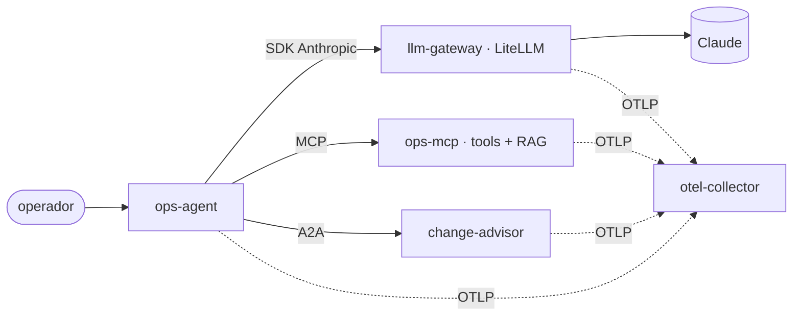

# agentes-ia

Ingeniería de agentes de IA llevada a la práctica: un **sistema de referencia de punta a
punta**, ejecutable y con tests, y el **harness** con el que desarrollo software con agentes.

La idea es profundidad antes que amplitud. Hay un único agente, y cada carpeta documenta e
implementa una pieza de ese mismo sistema:
- el agente usa tools por **MCP**;
- delega en otro agente por **A2A**;
- llama al modelo a través de un **gateway**;
- tiene **guardrails** contra prompt injection y aprobación humana para los efectos;
- emite **trazas OpenTelemetry**;
- se evalúa con **evals** en CI;
- se despliega en **Kubernetes** con **Terraform**.



## Mapa

| Carpeta | Qué hay |
| --- | --- |
| [`reference-agent/`](reference-agent/) | **ops-assistant**: bucle de tool use con Claude, aprobación humana, API HTTP y CLI |
| [`mcp/`](mcp/) | servidor MCP base: tools asíncronas organizadas por carpetas, logging estructurado, OAuth 2.1 por scopes y Streamable HTTP sin estado |
| [`a2a/`](a2a/) | change advisor: agente A2A de otro "equipo" con Agent Card y artefactos estructurados |
| [`llm-gateway/`](llm-gateway/) | LiteLLM: claves, reintentos, fallback Opus → Sonnet, presupuesto, trazas |
| [`guardrails-security/`](guardrails-security/) | política de tools, detección de inyección, spotlighting, redacción y modelo de amenazas (OWASP ASI) |
| [`rag-and-memory/`](rag-and-memory/) | recuperación BM25 o híbrida con RRF y memoria de sesión append-only |
| [`observability/`](observability/) | OpenTelemetry con convenciones GenAI, coste por conversación y collector con gobierno del dato |
| [`evals-and-benchmarks/`](evals-and-benchmarks/) | evals de trayectoria, juez LLM calibrado (kappa), pass^k y benchmarks offline con umbrales |
| [`agent-patterns/`](agent-patterns/) | catálogo de patrones (y antipatrones) con enlaces a su implementación aquí |
| [`architecture/`](architecture/) | arquitectura de referencia, 8 ADRs y checklist de producción |
| [`deploy/`](deploy/) | Dockerfile, manifiestos de Kubernetes y Terraform (AKS, ACR, Key Vault); sin Helm ni Kustomize |
| [`harness-engineering/`](harness-engineering/) | harness SDD multiagente para Claude Code (0.8.0), su variante con olas (features en paralelo en worktrees), caso de estudio con métricas reales y harnesses de dominio |

## Arranque rápido

Requisitos: [uv](https://docs.astral.sh/uv/) y Python 3.12.

```bash
uv sync                  # entorno del espacio de trabajo (7 paquetes)
make test                # tests de todo el sistema, sin red ni coste
make bench               # benchmarks offline con umbrales
ANTHROPIC_API_KEY=... make chat   # el agente en tu terminal: MCP por stdio, A2A en proceso
```

> En WSL, crea el entorno en el sistema de archivos de Linux (o clona el repo allí):
> `UV_PROJECT_ENVIRONMENT=~/.venvs/agentes-ia uv sync`. Sobre `/mnt/c` o `/mnt/d` los
> imports son unas 10 veces más lentos.

Despliegue en kind o AKS: [`deploy/README.md`](deploy/README.md).

## Estado verificado

| Qué | Resultado |
| --- | --- |
| Tests del sistema (7 paquetes) | 59 en verde, sin red |
| Tests del harness | base: 95 · con olas: 100, incluido `ola.sh` con worktrees reales (Python 3.10 y 3.12) |
| Recuperación (BM25) | recall@3 0,94 · MRR 0,83 |
| Detector de inyección | precisión 1,0 · recall 1,0 en el corpus (ver límites en [`guardrails-security`](guardrails-security/)) |
| Prueba de punta a punta | agente, LiteLLM, MCP y A2A como procesos separados contra un mock del proveedor: traza compartida y fallback ante 529 |
| Kubernetes | manifiestos y render de la plantilla de Azure válidos con `kubeconform -strict` (1.37) |
| Terraform | `validate` correcto con azurerm 5.11 |

## Versiones

| Pieza | Versión |
| --- | --- |
| Modelos | `claude-opus-5-5` (agente y juez); `claude-sonnet-5-5` (fallback) |
| SDK de Anthropic | `anthropic` 2.3 (spans OTel nativos) |
| MCP | `mcp` 2.3 (`MCPServer`, `Client`) |
| A2A | `a2a-sdk` 1.2 (protocolo A2A 1.0) |
| Gateway | LiteLLM 1.106.3 |
| OpenTelemetry | SDK 1.45, collector contrib 0.163.2 |
| Infraestructura | Kubernetes 1.37, Terraform 1.17, azurerm 5.11 |

## Licencia

[Apache 2.0](LICENSE).
