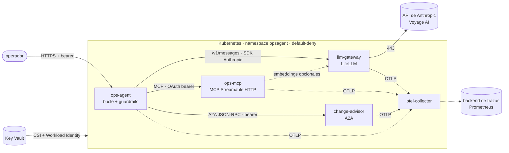

# Arquitectura de referencia

Un agente de IA en producción no es un prompt: es un sistema distribuido con un componente
no determinista en el centro. Esta carpeta describe el sistema del repositorio y las
decisiones que lo sostienen.

## Vista de componentes

| Componente | Responsabilidad | Escala | Estado |
| --- | --- | --- | --- |
| ops-agent | bucle del agente, política de tools, aprobación humana, redacción | 1 réplica (sesiones en memoria) | sesiones con TTL |
| llm-gateway | claves, reintentos, fallback, presupuesto, trazas del proveedor | horizontal | ninguno (presupuesto en memoria) |
| ops-mcp | tools de operaciones y RAG, autorización por scopes | horizontal (HPA) | ninguno (stateless HTTP) |
| change-advisor | política de cambios de otro equipo | horizontal | ninguno |
| otel-collector | gobierno y enrutado de la telemetría | 1+ | ninguno |

## Flujo de una petición

1. El operador envía su pregunta a `POST /v1/chat`. La API valida el token y abre el span
   `invoke_agent`.
2. El agente llama al modelo por el gateway con las tools del servidor MCP y la del change
   advisor.
3. Por cada `tool_use`, la política decide: ejecutar (lectura), pausar para aprobación
   (efectos) o denegar (fuera de la lista, límite agotado o sesión contaminada).
4. Cada resultado se redacta, se analiza en busca de inyección y vuelve al modelo envuelto
   como dato no confiable.
5. La respuesta final se redacta y se devuelve con la trayectoria, el uso y el coste. Si
   hay una acción pendiente, `POST /v1/sessions/{id}/approval` la resuelve y el bucle continúa.

## Fronteras de confianza

- **Confiables**: el operador autenticado, el código y la configuración desplegados.
- **No confiables**: todo lo que devuelven el modelo, el servidor MCP (datos de terceros:
  mensajes de commit, notas) y el change advisor. El modelo de amenazas completo está en
  [`guardrails-security/THREAT-MODEL.md`](../guardrails-security/THREAT-MODEL.md).

## Decisiones (ADR)

| ADR | Decisión |
| --- | --- |
| [0001](adr/0001-bucle-propio.md) | Bucle de tool use propio con el SDK de Anthropic, sin framework de agentes |
| [0002](adr/0002-gateway-llm.md) | Gateway LiteLLM delante del proveedor; la app usa el SDK nativo |
| [0003](adr/0003-mcp-stateless-oauth.md) | Tools en un servidor MCP stateless con OAuth 2.1 por scopes |
| [0004](adr/0004-a2a-entre-equipos.md) | A2A solo para delegar entre agentes de equipos distintos |
| [0005](adr/0005-rag-bm25-primero.md) | RAG con BM25 como línea base medida; híbrido y pgvector cuando los datos lo pidan |
| [0006](adr/0006-estado-de-sesion.md) | Sesiones append-only en memoria detrás de un protocolo sustituible |
| [0007](adr/0007-guardrails-deterministas.md) | Guardrails deterministas y aprobación humana; la detección no es la defensa |
| [0008](adr/0008-kubernetes-terraform.md) | Manifiestos de Kubernetes y Terraform, sin Helm ni Kustomize; secretos de Key Vault sincronizados |

Antes de llevar algo así a producción: [`production-checklist.md`](production-checklist.md).
