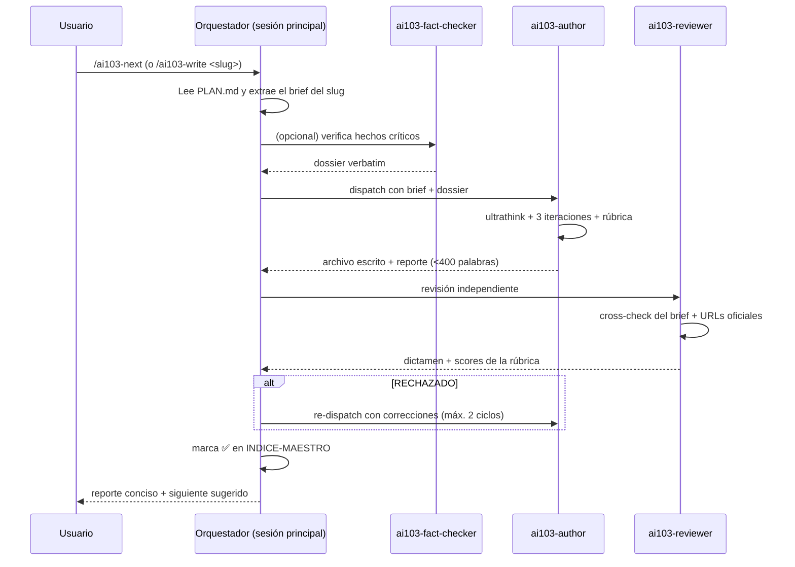

# Harness AI-103 — Vista rápida

> Agentes y slash commands de Claude Code para construir y estudiar un vault
> Obsidian de **168 archivos atómicos** para la certificación Microsoft
> **AI-103: Developing AI Apps and Agents on Azure** (sucesor del AI-102).
> Documentación completa: [`README-detailed.md`](README-detailed.md).

## Instalación

El harness vive dentro del vault de apuntes:

```bash
mkdir -p <vault>/.claude
cp -r agents commands <vault>/.claude/
cp settings.json.example <vault>/.claude/settings.local.json   # opcional: WebSearch sin preguntar
cd <vault> && claude
```

Todas las rutas de los agentes y comandos son **relativas a la raíz del vault**
(el directorio donde abres Claude Code). El vault necesita `PLAN.md` (briefs por
slug) e `INDICE-MAESTRO.md` (estado ⬜/✅ de cada archivo).

## Cómo funciona



## Calidad codificada en el harness

| Dónde | Qué garantiza |
| --- | --- |
| `ai103-author` (Opus) | Nivel doctoral, ultrathink, 3 iteraciones, rúbrica ≥ 9, ejemplos solo en Python, frontmatter Obsidian, ⚠️ para incertidumbres |
| `ai103-reviewer` (Opus) | Contexto limpio (no ve el proceso del autor), cross-check de ≥ 3 hechos contra Microsoft Learn, dictamen con acciones correctivas |
| `ai103-fact-checker` (Opus) | Solo fuentes oficiales (Microsoft Learn, PyPI Azure, GitHub Azure), copia verbatim con fecha de actualización |
| Briefs de `PLAN.md` | Sub-puntos verbatim del temario, URLs concretas, wikilinks, trampas concretas |
| Comandos | Ciclo autor → reviewer → marcar completado; máx. 2 ciclos de corrección antes de pedir intervención |

## Agentes (9)

`ai103-author`, `ai103-reviewer`, `ai103-fact-checker`, `ai103-organizer`,
`ai103-mock-exam-builder`, `ai103-vault-validator`, `ai103-study-aggregator`,
`ai103-flashcard-generator`, `ai103-coverage-analyst`. Detalle en
[`README-detailed.md` §5](README-detailed.md#5-agentes-en-detalle).

## Comandos principales (18 en total, `/ai103-help` los lista)

| Comando | Resultado |
| --- | --- |
| `/ai103-status` | Panel: completados, desglose por dominio y siguiente sugerido |
| `/ai103-next` | Siguiente archivo en orden pedagógico: autor + reviewer + reporte |
| `/ai103-write <slug>` | Genera un archivo concreto |
| `/ai103-batch <patrón>` | Genera en serie todos los archivos de un bloque (p. ej. `A.3`), con confirmación previa |
| `/ai103-review <slug>` | Revisa de nuevo un archivo ya escrito |
| `/ai103-brief <slug>` | Expande un brief antes del dispatch (útil si `PLAN.md` es escueto) |

## Permisos recomendados

`settings.json.example` permite `WebSearch` sin confirmación. Cópialo a
`<vault>/.claude/settings.local.json` si no quieres que los agentes pregunten
en cada búsqueda.
