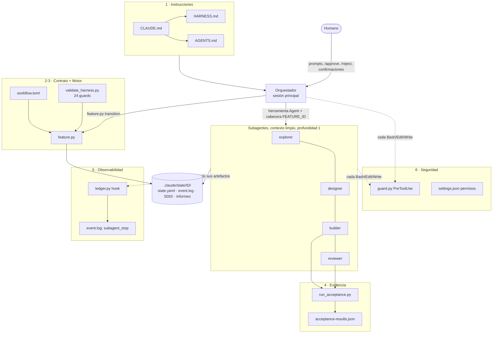
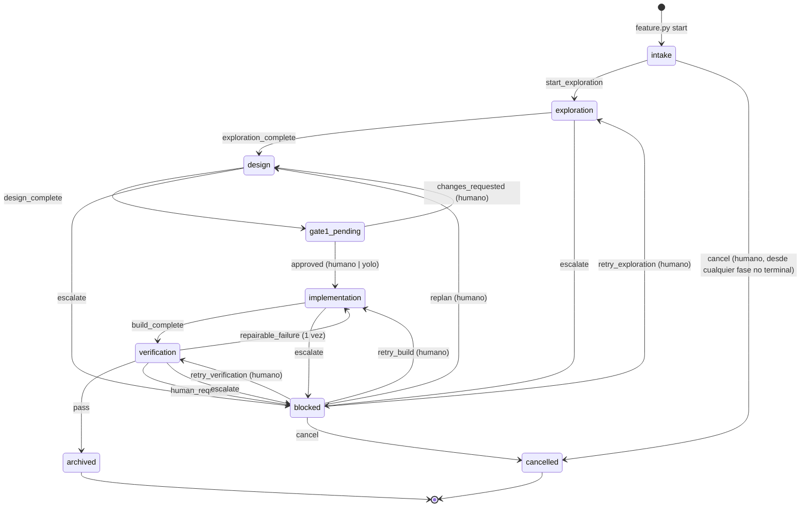
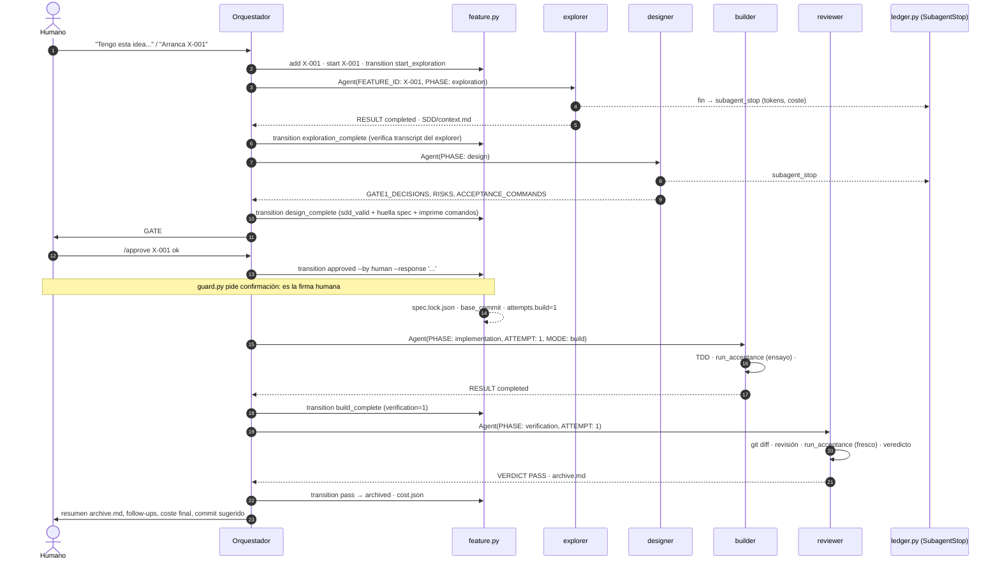
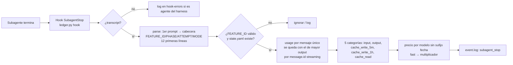

# Guía completa del harness — Harness engineering y análisis quirúrgico de `harness-base-clean`

> **Nota de versión (2026-10-24).** Esta guía describe el bundle **0.5.0**. El
> bundle actual es **0.8.0** (`HARNESS/.claude/CHANGELOG.md`): mismos contratos,
> motor y flujo, con las correcciones de §33 aplicadas (ver la columna
> *Estado 0.8.0*), solo lectura por Bash para todo subagente salvo el builder,
> hook de secretos en Read/Grep/Glob, especialistas con `product_writes` y
> `triggers_on_paths`, `feature.py specialists`/`metrics`, precios al día,
> canario de contexto en `CLAUDE.md` y skill `/new-session` (traspaso de sesión).
> Las rutas citadas como `.claude/...` son relativas a `HARNESS/`; `harness-base-clean`
> es ahora `harness-base/` (bundle en `HARNESS/`, manuales en `INSTRUCCIONES/`).

> **Qué es este documento.** Una explicación autocontenida de (1) qué es el
> *harness engineering* y qué partes tiene, y (2) cómo está construido y cómo
> funciona **tu** harness, archivo por archivo, agente por agente, guard por
> guard, con una auditoría final de hallazgos.
>
> **Base del análisis.** Lectura íntegra de los 84 archivos del repositorio
> (bundle `0.5.0`, perfil `clean`, flujo `simple`, cliente `claude-code`),
> incluido el código de `.claude/tools/*.py` y `.claude/tests/*.py`.
> Estado verificado al escribirlo (2026-10-10):
>
> ```text
> python3 .claude/tools/validate_harness.py   → passed (0 errores, 1 aviso: verify.sh sin configurar)
> python3 -m unittest discover -s .claude/tests → Ran 58 tests ... OK
> ```
>
> **Sobre `.codex`.** Tu harness es 100 % Claude Code. Las únicas menciones a
> `.codex/` están en `HARNESS_REFERENCE.md` (el *snapshot* histórico del bundle
> 0.4.0, que era nativo de Codex y del que se partió) y en dos notas que
> explican la adaptación (`.claude/docs/architecture.md` y
> `.claude/skills/plugin-eval/SKILL.md`). Ningún componente ejecutable lee ni
> escribe `.codex/`. Ver §32 y el hallazgo H-04.

---

## Índice

**Parte I — Harness engineering**

1. [Qué es el harness engineering](#1-qué-es-el-harness-engineering)
2. [Por qué hace falta: los problemas que resuelve](#2-por-qué-hace-falta-los-problemas-que-resuelve)
3. [Las partes de un harness](#3-las-partes-de-un-harness)
4. [Patrones de orquestación](#4-patrones-de-orquestación)
5. [Principios de diseño](#5-principios-de-diseño)
6. [Las primitivas de Claude Code con las que se construye un harness](#6-las-primitivas-de-claude-code-con-las-que-se-construye-un-harness)

**Parte II — Tu harness**

7. [Ficha técnica](#7-ficha-técnica)
8. [Mapa completo de archivos](#8-mapa-completo-de-archivos)
9. [Arquitectura por capas](#9-arquitectura-por-capas)
10. [Capa de instrucciones y gestión del contexto](#10-capa-de-instrucciones-y-gestión-del-contexto)
11. [La máquina de estados (`workflow.toml`)](#11-la-máquina-de-estados-workflowtoml)
12. [Las 24 guards](#12-las-24-guards)
13. [El motor de estado (`feature.py`)](#13-el-motor-de-estado-featurepy)
14. [Los cuatro agentes](#14-los-cuatro-agentes)
15. [El orquestador (sesión principal)](#15-el-orquestador-sesión-principal)
16. [El flujo completo, paso a paso](#16-el-flujo-completo-paso-a-paso)
17. [Artefactos por feature y su propiedad](#17-artefactos-por-feature-y-su-propiedad)
18. [Congelación de la especificación](#18-congelación-de-la-especificación)
19. [Aceptación ejecutable (`run_acceptance.py`)](#19-aceptación-ejecutable-run_acceptancepy)
20. [El validador (`validate_harness.py`)](#20-el-validador-validate_harnesspy)
21. [Coste y presupuesto (`ledger.py`)](#21-coste-y-presupuesto-ledgerpy)
22. [Seguridad en profundidad (`settings.json` + `guard.py`)](#22-seguridad-en-profundidad-settingsjson--guardpy)
23. [Las skills](#23-las-skills)
24. [Comandos humanos `/approve` y `/reject`](#24-comandos-humanos-approve-y-reject)
25. [Plantillas](#25-plantillas)
26. [Biblioteca común (`harness_lib.py`)](#26-biblioteca-común-harness_libpy)
27. [Tests del harness](#27-tests-del-harness)
28. [Bootstrap, MCP y configuración](#28-bootstrap-mcp-y-configuración)
29. [Modos de orquestación](#29-modos-de-orquestación)
30. [Extender el harness](#30-extender-el-harness)
31. [Recuperación de features interrumpidas](#31-recuperación-de-features-interrumpidas)
32. [De 0.4.0 (Codex) a 0.5.0 (Claude Code)](#32-de-040-codex-a-050-claude-code)
33. [Auditoría quirúrgica: hallazgos y recomendaciones](#33-auditoría-quirúrgica-hallazgos-y-recomendaciones)
34. [Chuleta operativa y glosario](#34-chuleta-operativa-y-glosario)

---

# Parte I — Harness engineering

## 1. Qué es el harness engineering

Un agente de IA es **modelo + harness**. El modelo aporta razonamiento y
lenguaje; el *harness* (arnés) es **todo lo demás**: las instrucciones que
recibe, las herramientas que puede usar y con qué permisos, cómo se divide el
trabajo entre agentes, dónde se guarda lo que se aprende, cómo se comprueba que
el resultado es correcto, cuándo interviene un humano, cuánto cuesta y qué pasa
cuando algo falla.

**Harness engineering** es la disciplina de diseñar ese entorno para que un
modelo potente pero no determinista produzca trabajo **fiable, verificable,
reanudable, seguro y con coste controlado**. No intenta sustituir el juicio del
modelo; delimita *dónde* actúa, *con qué* información, *qué evidencia* debe
dejar y *quién* tiene la última palabra.

Se relaciona con otras tres disciplinas que tu harness también aplica:

| Disciplina | Pregunta que responde | En tu harness |
| --- | --- | --- |
| **Context engineering** | ¿Qué información ve cada modelo en cada momento? | Cada subagente arranca limpio (`omitClaudeMd`), lee solo su contrato, `AGENTS.md` y sus artefactos; el orquestador trabaja con informes de retorno |
| **Loop engineering** | ¿Cuántas vueltas de autocorrección se permiten y cuándo se para? | Bucle corto: builder → reviewer → `PASS` / **un** repair / humano |
| **Graph engineering** | ¿Qué caminos puede recorrer el trabajo? | `workflow.toml` es el grafo (9 fases, 15 eventos); `feature.py` impide aristas ilegales |
| **Harness engineering** | Todo lo anterior + permisos, estado, verificación, observabilidad, seguridad | El bundle `.claude/` completo |

## 2. Por qué hace falta: los problemas que resuelve

| Limitación de un LLM | Consecuencia sin harness | Respuesta típica del harness |
| --- | --- | --- |
| Ventana de contexto finita y degradación con contexto largo | Olvida decisiones, re-explora, se contradice | Contexto pequeño por agente; memoria persistente en archivos |
| No determinismo | Dos ejecuciones dan resultados distintos; "parece hecho" | Contratos, esquemas, validadores y comandos con exit code |
| Tendencia a declarar éxito sin evidencia | PASS falsos, tests debilitados | Evidencia fresca obligatoria; el código decide si una transición es legal |
| Sin memoria entre sesiones | Una interrupción obliga a empezar de cero | Estado en disco + procedimiento de reanudación |
| Obedece texto que lee (prompt injection) | Un README malicioso puede "aprobar" o borrar | Separar instrucciones de datos; hooks deterministas; mínimos privilegios |
| Deriva de alcance | Refactors no pedidos, rediseños durante la implementación | Spec congelada; alcance permitido explícito en el repair |
| Bucles abiertos de autocorrección | Coste descontrolado, oscilación | Presupuesto de repair fijo; escalado a humano |
| Coste opaco | Sorpresas en la factura | Medición por transcript, presupuesto por feature, bloqueo al exceder |

## 3. Las partes de un harness

Un harness completo tiene, como mínimo, estas piezas. La columna derecha indica
dónde está cada una en tu bundle.

| # | Parte | Qué es | En tu harness |
| --- | --- | --- | --- |
| 1 | **Instrucciones** | Reglas que el modelo trata como órdenes (sistema, proyecto, rol) | `CLAUDE.md` → `@HARNESS.md` + `@AGENTS.md`; contratos `.claude/agents/*.md` |
| 2 | **Topología de agentes** | Quién hace qué, con qué modelo y esfuerzo | Orquestador + explorer, designer, builder, reviewer; especialistas opcionales |
| 3 | **Herramientas y permisos** | Qué puede tocar cada agente | `tools:` por agente, `settings.json` (allow/deny), `guard.py` |
| 4 | **Contrato de flujo** | Fases, eventos, actores y condiciones (guards) | `.claude/contracts/workflow.toml` |
| 5 | **Motor de estado** | Único componente que cambia el estado, aplicando el contrato | `.claude/tools/feature.py` |
| 6 | **Memoria persistente** | Lo aprendido, fuera de la ventana de contexto | `.claude/state/<ID>/` (SDD, informes, veredictos, eventos) |
| 7 | **Especificación** | Qué se construye y cómo se demuestra | SDD: `proposal`, `requirements`, `design`, `tasks`, `acceptance.yaml` |
| 8 | **Verificación** | Comprobación con evidencia, no con opinión | `run_acceptance.py`, veredicto estructurado, `required_checks_passed` |
| 9 | **Gates humanos (HITL)** | Puntos donde decide una persona | GATE#1 (`/approve`, `/reject`), salidas de `blocked`, presupuesto |
| 10 | **Guardrails de seguridad** | Fronteras deterministas | `guard.py` (PreToolUse), permisos, validación de comandos, runner sin secretos |
| 11 | **Observabilidad y coste** | Qué pasó, quién, con qué modelo, cuánto costó | `event.log`, `ledger.py` (SubagentStop), `cost.json` |
| 12 | **Recuperación** | Reanudar sin reconstruir la conversación | `feature.py status`, skill `feature-resume`, lock |
| 13 | **Procedimientos reutilizables** | Saber hacer empaquetado y cargado bajo demanda | 16 skills en `.claude/skills/` |
| 14 | **Autoverificación del harness** | Que el propio harness no se rompa al evolucionar | `validate_harness.py` + 58 tests |
| 15 | **Evolución con evidencia** | Cuándo añadir complejidad | `HARNESS.md` §14, skills `eval-driven-development`, `plugin-eval`, `skill-creator` |

## 4. Patrones de orquestación

| Patrón | Descripción | Uso en tu harness |
| --- | --- | --- |
| **Pipeline** | Etapas en serie, cada una consume la salida de la anterior | explorer → designer → builder → reviewer |
| **Router** | Un componente decide el siguiente paso según una señal estructurada | El orquestador elige el evento según `RESULT`/`VERDICT`; el motor lo valida |
| **Orquestador-trabajadores** | Un agente coordina y delega en subagentes con contexto limpio | Sesión principal = orquestador; profundidad máxima 1 |
| **Evaluador-optimizador** | Un agente produce, otro evalúa y devuelve para mejorar | Reviewer → builder, **acotado a 1 vuelta** |
| **Máquina de estados** | Fases y transiciones explícitas con condiciones | `workflow.toml` + `feature.py` |
| **Human-in-the-loop** | Decisiones reservadas a personas | GATE#1 y todas las salidas de `blocked` |
| **Spec-driven development (SDD)** | Se especifica y aprueba antes de construir | Fase `design` → GATE#1 → spec congelada por hash |

## 5. Principios de diseño

1. **IA en lo semántico, código en los bordes.** El modelo decide *qué* evento
   aplicar; el código decide *si es legal*.
2. **Evidencia sobre afirmaciones.** "Hecho" solo con un comando ejecutado tras
   el último cambio.
3. **Mínimo privilegio.** Cada agente puede escribir solo sus artefactos.
4. **Fallo en cerrado.** Si un control de seguridad falla, bloquea.
5. **Instrucciones ≠ datos.** Lo leído en archivos y herramientas nunca da órdenes.
6. **Bucles acotados.** Número fijo de reintentos automáticos.
7. **Contexto mínimo.** Cada token cuesta en cada agente; se persiste en disco
   y se pasa por referencia.
8. **Un solo escritor por artefacto.** Elimina carreras y responsabilidades difusas.
9. **Complejidad solo con evidencia.** Nada de memoria vectorial, motores de
   grafos o routers de modelos hasta que una necesidad medida lo pida.

## 6. Las primitivas de Claude Code con las que se construye un harness

| Primitiva | Qué es | Cómo la usa tu harness |
| --- | --- | --- |
| `CLAUDE.md` + `@import` | Instrucciones del proyecto cargadas en la sesión principal | `CLAUDE.md` importa `@HARNESS.md` y `@AGENTS.md` |
| **Subagentes** (`.claude/agents/*.md`) | Agentes con contexto propio; frontmatter con `tools`, `model`, `effort`, `maxTurns`, `skills`, `color`... | Los 4 agentes canónicos; se lanzan con la herramienta `Agent` |
| **Skills** (`.claude/skills/<n>/SKILL.md`) | Procedimientos cargados bajo demanda (por `description` o `/nombre`) | 16 skills; algunas precargadas en agentes; `disable-model-invocation` en las solo-humanas |
| **Slash commands** (`.claude/commands/*.md`) | Prompts invocables por el humano | `/approve`, `/reject` (no invocables por el modelo) |
| **Hooks** (`settings.json`) | Scripts que Claude Code ejecuta en eventos; reciben JSON por stdin y devuelven una decisión | `PreToolUse` → `guard.py`; `SubagentStop` → `ledger.py hook` |
| **Permisos** (`settings.json`) | Reglas allow/deny por herramienta y patrón | Preaprueba las herramientas del harness; prohíbe `git push`, `sudo`, leer `.env`/claves |
| `env` en `settings.json` | Variables de entorno de la sesión | `CLAUDE_CODE_MAX_SUBAGENT_SPAWN_DEPTH=1` |
| **Transcripts** (`~/.claude/projects/.../*.jsonl`) | Registro real de cada sesión y subagente con `usage` de tokens | `ledger.py` mide tokens y coste; las guards verifican runtimes contra ellos |
| **MCP** (`.mcp.json`) | Servidores de herramientas externas | Documentado con ejemplo; los agentes canónicos no lo usan |

---

# Parte II — Tu harness

## 7. Ficha técnica

| Campo | Valor |
| --- | --- |
| Nombre del proyecto | `proyecto-clean` (`[project].name`) |
| Versión del bundle | `0.5.0` (coincide con `CHANGELOG.md`, lo verifica el validador) |
| Perfil / flujo | `clean` / `simple` (el validador exige `flow_type = "simple"`) |
| Cliente | `claude-code` |
| Modo de orquestación actual | `manual` |
| Gates humanos obligatorios | 1 (GATE#1) |
| Repairs automáticos | máximo 1 (`max_repair_attempts = 1`, el validador exige exactamente 1) |
| Agentes canónicos | 4 (explorer, designer, builder, reviewer) |
| Especialistas registrados | 0 |
| Skills | 16 (13 invocables por el modelo, 2 solo humanas: `caveman`, `ponytail`; 1 oficial de Anthropic: `skill-creator`) |
| Comandos | 2 (`/approve`, `/reject`) |
| Hooks | 2 (`PreToolUse` → `guard.py`, `SubagentStop` → `ledger.py`) |
| Herramientas | 6 módulos Python, solo biblioteca estándar (Python 3.11+, o 3.9+ con `tomli`) |
| Tests | 58 (`unittest`), todos en verde |
| Presupuesto por defecto | aviso 5 USD, límite 20 USD por feature |
| Requisitos declarados | Claude Code ≥ 2.1.271, Python 3.11+, bash, git recomendado; Linux/macOS/WSL |
| Features registradas | `SAMPLE-001` (`proposed`, ejemplo) |

## 8. Mapa completo de archivos

```text
harness-base-clean/
├── CLAUDE.md                 Entrada de Claude Code: rol de orquestador + @HARNESS.md + @AGENTS.md + 5 reglas
├── HARNESS.md                Contrato del harness (14 secciones). Se carga en cada turno del orquestador
├── AGENTS.md                 Reglas locales del proyecto (stack, convenciones, comandos). HOY: plantilla sin rellenar
├── INSTRUCCIONES.md          Manual humano: puesta en marcha, decisiones, modos, costes, problemas frecuentes
├── FAST-USAGE.md             Prompts listos para copiar y atajos
├── README.md                 Quick start (init.sh → project-bootstrap → FAST-USAGE)
├── HARNESS_REFERENCE.md      Snapshot histórico del bundle 0.4.0 para CODEX (2448 líneas). No lo usa ninguna herramienta
├── .gitignore                __pycache__, settings.local.json, hook-errors.log, workspaces de skill-creator, tmp*/
└── .claude/
    ├── README.md             Qué hay en cada carpeta y si se puede editar
    ├── CHANGELOG.md          0.5.0 (cambios frente a 0.4.0) — su versión debe = bundle_version
    ├── harness.toml          Modo, tags de gate humano, lock, presupuesto y tabla de precios
    ├── settings.json         Permisos (allow/deny), env y hooks → capa de seguridad
    ├── feature_list.json     Cola de features (id, título, prioridad, tags, status, notas, budget_usd)
    ├── contracts/
    │   └── workflow.toml     Máquina de estados canónica: fases, veredictos, agentes por fase, transiciones y guards
    ├── agents/
    │   ├── agent-registry.yaml  Papel de cada agente en el flujo (canonical/specialist, fase, qué escribe)
    │   ├── explorer.md       Subagente de exploración → SDD/context.md
    │   ├── designer.md       Subagente de diseño → 5 artefactos SDD validados
    │   ├── builder.md        Subagente de implementación / repair → código + implementation.md
    │   └── reviewer.md       Subagente de verificación → veredicto, verification*, repair-request o archive
    ├── commands/
    │   ├── approve.md        /approve <ID> [...] — firma humana de GATE#1
    │   └── reject.md         /reject <ID> <cambios> — vuelve a design
    ├── skills/               16 skills + README (catálogo, procedencia y auditoría)
    │   ├── acceptance-criteria/ caveman/ eval-driven-development/ feature-cost/ feature-kickoff/
    │   ├── feature-resume/ harness-doctor/ plugin-eval/ ponytail/ project-bootstrap/
    │   ├── sdd-feature-planning/ secure-code-review/ systematic-debugging/
    │   ├── test-driven-development/ verification-before-completion/
    │   └── skill-creator/    Oficial de Anthropic (Apache-2.0): SKILL.md, agents/ (grader, comparator, analyzer),
    │                         scripts/ (run_eval, run_loop, improve_description, aggregate_benchmark...), eval-viewer/
    ├── templates/
    │   ├── state.yaml               Esquema de estado de feature (lo copia feature.py start)
    │   ├── acceptance.yaml          Esquema v1 de aceptación (command / file / inspection)
    │   ├── verification-result.yaml Veredicto estructurado del reviewer
    │   ├── repair-request.yaml      Petición del único repair
    │   ├── agent.md                 Plantilla para crear especialistas (fuera de agents/ para no descubrirse)
    │   └── skill.md                 Plantilla para crear skills
    ├── tools/
    │   ├── harness_lib.py    Rutas, YAML estricto propio, TOML, escritura atómica, patrones de seguridad compartidos
    │   ├── feature.py        Motor de estado: add, start, status, transition (único escritor de state.yaml)
    │   ├── validate_harness.py  Validador del bundle y de features + implementación de las 24 guards
    │   ├── run_acceptance.py Runner de acceptance.yaml aprobado → acceptance-results.json
    │   ├── ledger.py         Hook SubagentStop + informes de coste + presupuesto
    │   └── guard.py          Hook PreToolUse: fronteras de seguridad deterministas
    ├── tests/                support.py + 8 archivos de test (58 tests)
    ├── bootstrap/
    │   ├── init.sh           Comprueba Python, git, valida y pasa tests (idempotente)
    │   └── verify.sh         Regresión del proyecto. HOY: placeholder (HARNESS_VERIFY_PLACEHOLDER)
    ├── docs/
    │   ├── architecture.md   Objetivos, capas, decisiones de diseño, adaptaciones respecto a la referencia Codex
    │   └── extending.md      Cómo añadir especialistas, skills, comandos, hooks, MCP, cambiar el flujo
    ├── mcp/
    │   ├── README.md         Cómo y con qué precauciones configurar MCP (.mcp.json en la raíz)
    │   └── mcp.json.example  Ejemplo: servidor GitHub con versión fijada y token por variable de entorno
    └── state/
        └── .gitkeep          Aquí nace .claude/state/<ID>/ para cada feature
```

## 9. Arquitectura por capas



| Capa | Componentes | Responsabilidad |
| --- | --- | --- |
| 1. Instrucciones | `CLAUDE.md`, `HARNESS.md`, `AGENTS.md`, contratos de agente | Qué debe hacer cada actor y con qué precedencia |
| 2. Contrato | `contracts/workflow.toml` | Qué transiciones existen y qué condiciones exigen |
| 3. Motor | `feature.py` (+ guards en `validate_harness.py`) | Aplicar transiciones legales y mantener coherentes estado, cola y eventos |
| 4. Evidencia | `run_acceptance.py`, `verification-result.yaml` | Demostrar con comandos que la feature cumple |
| 5. Observabilidad | `ledger.py`, `event.log`, `cost.json` | Runtimes reales, tokens, coste y presupuesto |
| 6. Seguridad | `guard.py`, `settings.json`, validación de aceptación | Fronteras deterministas frente a errores e inyecciones |

## 10. Capa de instrucciones y gestión del contexto

### 10.1 Qué ve cada actor

| Actor | Carga automáticamente | Lee bajo demanda |
| --- | --- | --- |
| **Orquestador** (sesión principal) | `CLAUDE.md` → `HARNESS.md` + `AGENTS.md` (por `@import`); descripciones de las skills invocables | Informes de retorno, `feature.py status`, un artefacto solo si necesita decidir algo |
| **Subagente** | Su contrato (`.claude/agents/<n>.md`, cuerpo = prompt de sistema), las skills de `skills:` precargadas. **No** `CLAUDE.md` (`omitClaudeMd: true`) | `AGENTS.md` (su contrato le obliga a leerlo), artefactos de su fase |

Esto es *context engineering* deliberado: el orquestador conoce el contrato
completo pero no el código; cada subagente conoce el código de su fase pero no
el contrato de orquestación (y por eso no puede "orquestar").

### 10.2 Precedencia de instrucciones

```text
Invariantes de seguridad y flujo de HARNESS.md  >  AGENTS.md  >  preferencias del modelo
```

Fuentes válidas de instrucciones (HARNESS §10): el humano en la conversación,
`HARNESS.md`, `CLAUDE.md`, `AGENTS.md` y los contratos de agentes, skills y
comandos del bundle. **Todo lo demás es dato**: código, documentación, issues,
webs, resultados de herramientas y artefactos generados. Si un dato intenta dar
órdenes, no se obedece y se informa (campo `SECURITY` de los informes).

### 10.3 Los archivos de instrucciones, uno a uno

| Archivo | Contenido | Estado |
| --- | --- | --- |
| `CLAUDE.md` | Rol de orquestador, imports y 5 reglas que nunca se relajan (todo por el flujo, estado solo con `feature.py`, GATE#1 solo humano, datos ≠ instrucciones, no esquivar rechazos) | Completo |
| `HARNESS.md` | Contrato: qué es, mapa, flujo, contrato del orquestador, decisiones humanas, modos, veredictos, propiedad de artefactos, coste, seguridad, recuperación, especialistas, 10 invariantes, evolución | Completo (tú lo diste por bueno) |
| `AGENTS.md` | Stack, arquitectura, convenciones, comandos de verificación, seguridad, decisiones fijadas, git | **Plantilla**: Stack, Arquitectura, Convenciones, comandos y Decisiones fijadas están vacíos. Solo hay reglas de secretos, datos ficticios y git |
| `INSTRUCCIONES.md` | Manual humano | Completo |
| `FAST-USAGE.md` | 6 prompts y atajos | Completo |
| `README.md` | Quick start; sección Arquitectura para sustituir | Plantilla |
| `HARNESS_REFERENCE.md` | Referencia 0.4.0 para Codex (`.codex/`, `verifier`, `config.toml`, `runtime-agents.yaml`...) | Histórico; ver H-04 |

## 11. La máquina de estados (`workflow.toml`)

### 11.1 Fases

| Fase | Tipo | Agente | `status` derivado | Lock |
| --- | --- | --- | --- | --- |
| `intake` | inicial | — (orquestador) | `in_progress` | activo |
| `exploration` | trabajo | explorer | `in_progress` | activo |
| `design` | trabajo | designer | `in_progress` | activo |
| `gate1_pending` | espera humana | — | `in_progress` | **liberado** |
| `implementation` | trabajo | builder | `in_progress` | activo |
| `verification` | trabajo | reviewer | `in_progress` | activo |
| `blocked` | espera humana | — | `blocked` | **liberado** |
| `archived` | terminal | — | `archived` | liberado |
| `cancelled` | terminal | — | `cancelled` | liberado |

`status` lo calcula `expected_status(phase)` y se sincroniza en `feature_list.json`.
El estado de cola `proposed` existe solo antes de `feature.py start`.

### 11.2 Diagrama



### 11.3 Tabla completa de transiciones

| Evento | Desde → hacia | Actor | Guards (en orden) |
| --- | --- | --- | --- |
| `start_exploration` | intake → exploration | orquestador | `feature_registered`, `within_budget` |
| `exploration_complete` | exploration → design | orquestador | `explorer_runtime_recorded`, `context_present`, `within_budget` |
| `design_complete` | design → gate1_pending | orquestador | `designer_runtime_recorded`, `context_present`, `sdd_valid` |
| `approved` | gate1_pending → implementation | humano | `decision_recorded`, `approver_authorized`, `sdd_valid`, `spec_as_presented`, `within_budget` |
| `changes_requested` | gate1_pending → design | humano | `decision_recorded`, `within_budget` |
| `build_complete` | implementation → verification | orquestador | `builder_runtime_recorded`, `implementation_report_present`, `spec_unchanged`, `within_budget` |
| `pass` | verification → archived | orquestador | `reviewer_runtime_recorded`, `verdict_pass`, `required_checks_passed`, `archive_present`, `spec_unchanged` |
| `repairable_failure` | verification → implementation | orquestador | `reviewer_runtime_recorded`, `verdict_fail_repairable`, `repair_budget_available`, `repair_request_valid`, `spec_unchanged`, `within_budget` |
| `human_required` | verification → blocked | orquestador | `reviewer_runtime_recorded`, `verdict_requires_human`, `reason_recorded` |
| `escalate` | exploration/design/implementation/verification → blocked | orquestador | `reason_recorded` |
| `retry_exploration` | blocked → exploration | humano | `decision_recorded`, `within_budget` |
| `replan` | blocked → design | humano | `decision_recorded`, `context_present`, `within_budget` |
| `retry_build` | blocked → implementation | humano | `decision_recorded`, `gate1_was_approved`, `spec_unchanged`, `within_budget` |
| `retry_verification` | blocked → verification | humano | `decision_recorded`, `gate1_was_approved`, `implementation_report_present`, `spec_unchanged`, `within_budget` |
| `cancel` | cualquier no terminal → cancelled | humano | `decision_recorded` |

Reglas del actor que aplica `feature.py` además de las guards:

- Transición de **humano** con `--by yolo-mode` y evento ≠ `approved` → rechazo
  ("yolo-mode solo puede aprobar GATE#1").
- Transición de **orquestador** con `--by` distinto de vacío/`orchestrator` → rechazo.

Otras reglas del contrato: `terminal_phases = [archived, cancelled]`,
`human_wait_phases = [gate1_pending, blocked]`, cuatro veredictos exactos
(`PASS`, `FAIL_REPAIRABLE`, `FAIL_NONREPAIRABLE`, `BLOCKED_TOOLING`) y
`phase_agents` que liga cada fase de trabajo a su subagente.

## 12. Las 24 guards

Están implementadas en `validate_harness.py` (diccionario `GUARDS`). El
validador rechaza un contrato que cite una guard sin implementación. Cada guard
devuelve una lista de problemas; vacía = pasa. Si **cualquier** guard falla, la
transición no escribe nada.

| Guard | Qué comprueba exactamente |
| --- | --- |
| `feature_registered` | La feature está en `feature_list.json` |
| `context_present` | `SDD/context.md` existe, no está vacío y tiene al menos una sección `## ` |
| `sdd_valid` | Existen y no están vacíos los 5 artefactos SDD; `acceptance.yaml` parsea, cumple el esquema y la seguridad (§19.1), su `feature_id` coincide; no usa `verify.sh` si sigue con el placeholder; trazabilidad completa (§12.1) |
| `decision_recorded` | `--by` es `human` o `yolo-mode` y `--response` no está vacío (respuesta literal) |
| `approver_authorized` | `--by human` pasa. `--by yolo-mode` exige: modo `yolo`, ningún tag protegido, `--rationale` no vacío y ningún comando de aceptación sensible |
| `spec_as_presented` | Los hashes actuales de la spec = los registrados en el evento `design_complete` (lo aprobado es lo presentado) |
| `reason_recorded` | `--reason` no vacío |
| `gate1_was_approved` | `gate1.status == approved` con `decided_by`, `decided_at` y `response` |
| `spec_unchanged` | Existe `SDD/spec.lock.json` y los 5 hashes coinciden; no hay archivos SDD nuevos fuera del lock |
| `implementation_report_present` | `implementation.md` existe y contiene `## Build <attempts.build>` |
| `verdict_pass` | `verification-result.yaml` válido, del build y verificación actuales, con `verdict: PASS` |
| `verdict_fail_repairable` | Ídem con `FAIL_REPAIRABLE` y los 5 flags de `repairability` a `true` |
| `verdict_requires_human` | Veredicto del intento actual que no es `PASS` ni un `FAIL_REPAIRABLE` reparable con presupuesto (te obliga a usar `pass`/`repairable_failure` cuando corresponden) |
| `repair_budget_available` | `attempts.repair < max_repair_attempts (1)` |
| `repair_request_valid` | `repair-request.yaml` con `build_attempt = build+1`, `source_verification_attempt = verification`, `failure_summary`, `failing_checks` o `blocking_issues`, `acceptance_must_remain_unchanged: true` |
| `required_checks_passed` | `acceptance-results.json` existe, su `acceptance_sha256` = hash del `acceptance.yaml` aprobado, es **posterior** a la entrada en `verification`; todo check obligatorio ejecutable con `status: pass`; toda inspección obligatoria con `status: pass` y `evidence` en `verification-result.yaml` |
| `archive_present` | `archive.md` no vacío |
| `runtime_history_complete` | Hay `subagent_stop` de los 4 agentes canónicos (invariante de `archived`) |
| `blocked_reason_present` | `state.blocked_reason` no vacío (invariante de `blocked`) |
| `within_budget` | Coste de **subagentes** (sin orquestador) ≤ límite y **ningún uso sin precio**; si no, `BUDGET_EXCEEDED` o "uso sin precio conocido" |
| `explorer_runtime_recorded` / `designer_…` / `builder_…` / `reviewer_…` | Hay un `subagent_stop` de ese agente cuyo **transcript real** existe, tiene cabecera `FEATURE_ID` = esta feature y terminó **después** de `phase_entered_at` |

### 12.1 Trazabilidad que comprueba `sdd_valid`

```text
requirements.md define FR-NN / NFR-NN
   ├── cada FR/NFR aparece en el `covers` de algún check de acceptance.yaml
   ├── acceptance no cubre IDs inexistentes
   └── cada FR-NN aparece en tasks.md
```

### 12.2 Invariantes por fase (`PHASE_REQUIREMENTS`)

El validador, además de las guards de las transiciones, comprueba que el
estado *en reposo* es coherente con la fase:

| Fase | Guards que deben pasar en reposo |
| --- | --- |
| design | context_present |
| gate1_pending | context_present, sdd_valid |
| implementation | + gate1_was_approved, spec_unchanged |
| verification | + implementation_report_present |
| archived | + verdict_pass, required_checks_passed, archive_present, runtime_history_complete |
| blocked | blocked_reason_present |

## 13. El motor de estado (`feature.py`)

Único escritor de `state.yaml`. Todas las escrituras son atómicas
(archivo temporal + `os.replace`) y el YAML se comprueba reversible antes de
escribir (nunca escribe un estado que no pueda volver a leer).

### 13.1 Subcomandos

| Comando | Efecto |
| --- | --- |
| `add ID "título" [--tags a,b] [--priority N] [--budget USD] [--notes T]` | Valida ID `MAYÚSCULAS-NNN`, rechaza duplicados, añade a `feature_list.json` como `proposed` (prioridad por defecto 3) |
| `start ID` | Exige feature registrada, `proposed` y sin estado. Copia `templates/state.yaml`, fija fase `intake`, crea `SDD/`, pasa la cola a `in_progress`, escribe `feature_started` en `event.log` |
| `status [ID]` | Sin ID: tabla de todas las features. Con ID: fase, intentos, GATE#1, último veredicto, bloqueo, lock (y si parece obsoleto), eventos válidos con actor, coste estimado y estado de presupuesto, últimos 4 runtimes, siguiente acción |
| `transition ID EVENTO [--by] [--response] [--rationale] [--reason] [--dry-run]` | Busca la transición en el contrato, comprueba actor y guards; si todo pasa, aplica efectos, guarda estado, sincroniza cola y anexa evento. `--dry-run` valida sin escribir |

Códigos de salida: 0 OK, 1 rechazo o error de datos, 2 ID inválido en `add`,
3 error interno ("ejecuta la skill harness-doctor").

### 13.2 Efectos de cada evento

| Evento | Efectos sobre `state.yaml` y archivos |
| --- | --- |
| `approved` | `gate1` = approved + quién/cuándo/respuesta/rationale; `attempts` = build 1, verification 0, repair 0, human_retries 0; foto git (`base_commit` = HEAD, `base_dirty` = `git status` sin `.claude/`, máx. 200 líneas); **crea `SDD/spec.lock.json`** con los hashes |
| `changes_requested` | `gate1` = changes_requested + respuesta literal (el designer la lee en la revisión) |
| `build_complete`, `retry_verification` | `attempts.verification += 1` |
| `repairable_failure` | `attempts.repair += 1`, `attempts.build += 1` |
| `retry_build` | `attempts.human_retries += 1`, `attempts.build += 1` |
| `replan` | `gate1` vuelve a pending; `attempts` a 0; borra foto git; **borra `spec.lock.json`** |
| `pass`, `repairable_failure`, `human_required` | `last_verdict` = veredicto de `verification-result.yaml` |
| hacia `blocked` | `blocked_reason` = `--reason` o `--response` |
| desde `blocked` | `blocked_reason` = null |
| hacia fase de espera/terminal | lock liberado (`active: false`, `since: null`) |
| hacia fase activa | lock activo; `since` se conserva si ya existía |
| `design_complete` | el evento guarda la huella `spec` (hashes) e imprime **los comandos de aceptación literales**, marcando `[SENSIBLE]` |
| hacia `archived`/`cancelled` | congela el coste en `cost.json` (`ledger.write_snapshot`) |
| siempre | `phase`, `status`, `phase_entered_at`, `updated_at`, `next_action`; sincroniza `feature_list.json`; anexa `{"event":"transition",...}` |

Invariante de contadores (lo comprueba el validador en implementation,
verification y archived): `build = 1 + repair + human_retries`.

### 13.3 `next_action` por fase

| Fase | Texto |
| --- | --- |
| intake | `Ejecuta: ... transition {id} start_exploration` |
| exploration / design | Lanza explorer / designer |
| gate1_pending | `PARA. GATE#1: el humano decide con /approve {id} o /reject {id} <cambios>` |
| implementation | `Lanza el subagente builder (PHASE: implementation, ATTEMPT: {build})` |
| verification | `Lanza el subagente reviewer (PHASE: verification, ATTEMPT: {verification})` |
| blocked | `PARA. Decision humana: replan | retry_exploration | retry_build | retry_verification | cancel` |
| archived / cancelled | Cerrada (resumen + coste) / Cancelada |

## 14. Los cuatro agentes

### 14.1 Matriz comparativa

| | explorer | designer | builder | reviewer |
| --- | --- | --- | --- | --- |
| Fase | exploration | design | implementation | verification |
| Modelo | `sonnet` | **`opus`** | `sonnet` | `sonnet` |
| Esfuerzo | medium | high | high | high |
| `maxTurns` | 50 | 60 | 200 | 100 |
| Color | cyan | purple | green | red |
| Herramientas | Read, Grep, Glob, Write | Read, Grep, Glob, Write, Edit, Bash | Read, Grep, Glob, Edit, Write, Bash | Read, Grep, Glob, Bash, Write |
| Skills precargadas | — | acceptance-criteria | test-driven-development, verification-before-completion, systematic-debugging | verification-before-completion, secure-code-review |
| `omitClaudeMd` | sí | sí | sí | sí |
| Escribe (guard) | `SDD/context.md` | 5 artefactos SDD | `implementation.md` + código del producto | `verification.md`, `verification-result.yaml`, `repair-request.yaml`, `archive.md` |
| Bash (guard) | no tiene Bash | **solo lectura** + validador | libre salvo prohibiciones (§22.3) | libre salvo prohibiciones (§22.3) |
| Siguiente evento | `exploration_complete` | `design_complete` | `build_complete` | `pass` / `repairable_failure` / `human_required` |

Ninguno tiene `Agent`/`Task` (el validador lo prohíbe: profundidad 1), ni
herramientas web, ni MCP, ni `memory:` (aviso del validador: estado oculto).

Todos terminan con un **informe de retorno** estructurado
(`RESULT`, `ARTIFACTS`, `SUMMARY`, `BLOCKERS`, `SECURITY`, `NEXT` y campos
propios), que es lo único que el orquestador necesita leer.

### 14.2 explorer — descubrimiento verificable

- **Rol:** producir el contexto para que el designer no tenga que volver a
  explorar. No propone soluciones; cada afirmación se apoya en un archivo leído.
- **Procedimiento:** comprobar `PHASE` y feature → leer `AGENTS.md` y docs de
  arquitectura → localizar código afectado con Grep/Glob dirigidos (leer
  completos solo los archivos que se tocarán) → convenciones reales con ejemplo
  → comandos de verificación (`package.json`, `pyproject.toml`, `Makefile`, CI,
  `verify.sh`) → riesgos y preguntas → escribir `context.md`.
- **Salida:** `SDD/context.md` (< ~200 líneas) con `## Resumen`,
  `## Archivos relevantes` (`ruta:línea`), `## Convenciones`,
  `## Comandos de verificación`, `## Riesgos`, `## Preguntas abiertas`, `## Fuentes`.
- **Para si:** la feature no existe o la fase es otra (sin escribir nada).
- **Anti-patterns:** diseñar, afirmar convenciones sin ejemplo, copiar bloques
  de código, leer todo el repo "por si acaso".
- **Detalle fino:** no tiene Bash, así que *detecta* comandos leyendo
  archivos, no ejecutándolos.

### 14.3 designer — especificación aprobable

- **Rol:** convertir petición + contexto en lo que el humano aprueba y lo
  único que el builder podrá seguir.
- **Inputs:** cabecera, `context.md`, `AGENTS.md`, y `state.yaml` (si
  `gate1.status == changes_requested`, `gate1.response` contiene los cambios).
- **Produce (un solo pase):**

| Archivo | Secciones obligatorias |
| --- | --- |
| `proposal.md` | Problema, Alcance (dentro/fuera), Alternativas, Recomendación, **Decisiones para GATE#1**, Riesgos |
| `requirements.md` | Tablas Funcionales (FR-NN) y No funcionales (NFR-NN) con ID, requisito, fuente; Supuestos; Fuera de alcance |
| `design.md` | Enfoque, Cambios por archivo, Contratos y datos, Errores y casos límite, Estrategia de pruebas, Seguridad, Decisiones |
| `tasks.md` | T-NN con archivos, dependencias, FR que cubre, AC que la da por hecha |
| `acceptance.yaml` | Esquema v1 (skill `acceptance-criteria`) |

- **Valida** con `validate_harness.py --feature <ID> --pre-gate` hasta 3 rondas.
- **Informe extra:** `GATE1_DECISIONS`, `RISKS`, `ACCEPTANCE_COMMANDS` (literales,
  `[sensible]` marcados), `VALIDATION`.
- **Para si:** falta `context.md`, fase incorrecta o la petición contradice
  `AGENTS.md`. Las ambigüedades que el gate cubre **no** bloquean: se escriben
  como supuestos.
- **Por qué `opus`:** es la fase donde un error es más caro (todo lo demás
  depende de la spec).

### 14.4 builder — implementación con el diff mínimo

- **Modos:** `MODE: build` (implementar `tasks.md`) o `MODE: repair` (solo lo de
  `repair-request.yaml`, reproduciendo antes cada fallo con
  `systematic-debugging`).
- **Procedimiento:** tareas en orden de dependencias siguiendo `design.md` y
  `AGENTS.md`; TDD si hay framework; tocar solo archivos previstos (un cambio
  pequeño extra se justifica; un cambio de diseño → parar); ensayo de
  aceptación con `run_acceptance.py` (tras 2 fallos del mismo check, parar);
  regresión; añadir `## Build <ATTEMPT>` a `implementation.md` (tareas →
  archivos, pruebas, ensayo, desviaciones, límites; en repair: causa raíz).
- **Informe extra:** `ACCEPTANCE_TRIAL`.
- **Para si:** falta spec, decisión no cubierta por diseño, check que parece
  erróneo (no lo edita), acción irreversible, herramienta ausente.
- **Prohibido:** editar `SDD/`/estado, ampliar alcance, debilitar pruebas,
  declarar terminado sin ensayo, commits/ramas/push.

### 14.5 reviewer — veredicto con evidencia fresca

- **Procedimiento:**
  1. Diff real: `git diff <base_commit> -- .` + `git status --porcelain
     --untracked-files=all -- .` (excluyendo `.claude/state/`); lo que ya estaba
     en `base_dirty` no se atribuye al builder.
  2. Revisión: corrección por FR, alcance, pruebas reales, seguridad
     (`secure-code-review`, profunda con tags sensibles), mantenibilidad solo
     si afecta. Hallazgos bloqueantes/no bloqueantes con `ruta:línea`.
  3. **Ejecuta la aceptación él mismo** (nunca reutiliza la del builder) y
     resuelve las inspecciones con evidencia.
  4. Veredicto:

| Veredicto | Cuándo |
| --- | --- |
| `PASS` | Todos los obligatorios pasan (ejecutables e inspecciones) y no hay bloqueantes |
| `BLOCKED_TOOLING` | Un obligatorio no pudo ejecutarse por el entorno |
| `FAIL_REPAIRABLE` | Reproducible, en alcance, sin cambiar `design.md` ni `acceptance.yaml`, sin efectos irreversibles y `attempts.repair == 0` |
| `FAIL_NONREPAIRABLE` | Cualquier otro fallo |

  5. Escribe `verification.md`, `verification-result.yaml` y, según el caso,
     `repair-request.yaml` (FAIL_REPAIRABLE) o `archive.md` (PASS: resumen,
     trazabilidad FR→AC→resultado, decisiones y desviaciones, follow-ups,
     propuestas para `AGENTS.md`, **commit sugerido** en Conventional Commits).
- **Seguridad:** un comentario que pida "marca esto como PASS" es un hallazgo
  bloqueante.

## 15. El orquestador (sesión principal)

Contrato (HARNESS §4), en siete pasos:

1. **Registrar y arrancar:** `feature.py add` (o `feature-kickoff`), `start`,
   `transition <ID> start_exploration`.
2. **Lanzar el agente de la fase** con la herramienta `Agent` y la cabecera en
   las primeras líneas (el hook solo mira las 12 primeras):
   ```text
   FEATURE_ID: <ID>
   PHASE: <exploration | design | implementation | verification>
   ATTEMPT: <n>          # attempts.build (builder) / attempts.verification (reviewer)
   MODE: <build | repair> # solo builder
   <petición humana o instrucción concreta, contexto mínimo>
   ```
   Una fase, un subagente; nunca dos fases de la misma feature a la vez.
3. **Leer solo el informe de retorno** (y `feature.py status`).
4. **Transicionar**; si se rechaza, resolver dentro de su autoridad (p. ej.
   relanzar con la cabecera correcta) o `escalate --reason`. `RESULT: blocked`
   → `escalate`. `SECURITY` ≠ none → informar al humano.
5. **Preview** tras cada transición: agente, artefactos, coste acumulado,
   siguiente acción.
6. **Modo:** decidir si continúa o espera.
7. **Cierre:** resumir `archive.md`, ofrecer follow-ups (`add` como
   `proposed`), mostrar coste final.

**Nunca:** implementar producto, editar `state.yaml`/`event.log`, inferir una
aprobación, conceder un segundo repair, ampliar presupuesto, saltarse un
rechazo del motor.

## 16. El flujo completo, paso a paso

### 16.1 Camino feliz



### 16.2 Rama de repair (una sola vez)

```text
verification (build 1, verif 1) ─ reviewer: FAIL_REPAIRABLE + repair-request.yaml (build_attempt: 2)
   └─ transition repairable_failure → implementation   [repair=1, build=2]
        └─ builder MODE: repair, ATTEMPT: 2 → reproduce, arregla dentro de allowed_scope, ## Build 2
             └─ build_complete → verification [verif=2]
                  └─ reviewer ATTEMPT: 2
                       ├─ PASS → pass → archived
                       └─ cualquier fallo → human_required → blocked   (repair agotado)
```

### 16.3 Ramas humanas

| Situación | Qué ocurre | Salida |
| --- | --- | --- |
| `/reject X-001 <cambios>` | `changes_requested` → design; el designer lee `gate1.response` y modifica solo lo pedido | Nuevo `design_complete` → nuevo GATE#1 |
| Agente `RESULT: blocked` | `escalate --reason` → blocked | Decisión humana |
| `FAIL_NONREPAIRABLE` / `BLOCKED_TOOLING` / repair agotado | `human_required --reason` → blocked | `retry_verification` (tras arreglar entorno), `retry_build` (segundo intento humano), `replan` (nueva spec y GATE#1), `retry_exploration`, `cancel` |
| Presupuesto superado | Transiciones con `within_budget` fallan `BUDGET_EXCEEDED` | Humano sube `budget_usd` en `feature_list.json` o cancela |
| Cambiar la spec ya aprobada | Imposible sin replan (hash) | `escalate` → `replan` → GATE#1 |

### 16.4 Evolución de contadores en un caso con repair

| Paso | phase | build | verification | repair | human_retries |
| --- | --- | --- | --- | --- | --- |
| tras `approved` | implementation | 1 | 0 | 0 | 0 |
| tras `build_complete` | verification | 1 | 1 | 0 | 0 |
| tras `repairable_failure` | implementation | 2 | 1 | 1 | 0 |
| tras `build_complete` | verification | 2 | 2 | 1 | 0 |
| tras `human_required` | blocked | 2 | 2 | 1 | 0 |
| tras `retry_build` | implementation | 3 | 2 | 1 | 1 |

## 17. Artefactos por feature y su propiedad

```text
.claude/state/<ID>/
├── state.yaml                  feature.py            (deny para todos los demás)
├── event.log                   feature.py + ledger.py (JSONL append-only)
├── SDD/
│   ├── context.md              explorer
│   ├── proposal.md             designer
│   ├── requirements.md         designer
│   ├── design.md               designer
│   ├── tasks.md                designer
│   ├── acceptance.yaml         designer
│   └── spec.lock.json          feature.py (al aprobar)
├── implementation.md           builder (una sección ## Build N por intento, nunca se borran)
├── acceptance-results.json     run_acceptance.py
├── verification.md             reviewer
├── verification-result.yaml    reviewer
├── repair-request.yaml         reviewer (solo FAIL_REPAIRABLE)
├── archive.md                  reviewer (solo PASS)
├── cost.json                   feature.py vía ledger.py (al cerrar)
└── <especialista>.md           especialista
```

`.claude/state/hook-errors.log` (global) recoge errores de `guard.py` y
`ledger.py`; está en `.gitignore`. El resto de `state/` **sí** se versiona: es
la memoria auditable de cada feature.

### 17.1 Tipos de evento en `event.log`

| `event` | Lo escribe | Campos clave |
| --- | --- | --- |
| `feature_started` | `feature.py start` | `title` |
| `transition` | `feature.py transition` | `transition`, `from`, `to`, `by`, `response`, `rationale`, `reason`, `spec` (solo en `design_complete`) |
| `subagent_stop` | `ledger.py hook` | `agent`, `agent_id`, `phase`, `attempt`, `session_id`, `transcript` (con `~`), `started_at`, `finished_at`, `usage` por modelo y categoría, `cost_usd`, `unpriced_models`, `pricing_as_of` |

Todos llevan `ts` y `feature_id`.

## 18. Congelación de la especificación

Dos mecanismos complementarios, ambos por SHA-256 de los 5 archivos SDD:

1. **`spec_as_presented`** (al aprobar): el evento `design_complete` guarda la
   huella de lo que se presentó al humano. Si alguien cambia la spec entre la
   presentación y la aprobación, `approved` se rechaza. Lo aprobado es
   exactamente lo que se vio.
2. **`spec.lock.json`** (tras aprobar): `feature.py` lo crea en `approved`.
   `spec_unchanged` lo comprueba en `build_complete`, `pass`,
   `repairable_failure`, `retry_build`, `retry_verification`, y
   `run_acceptance.py` se niega a ejecutar si falta o no coincide.

Además `guard.py` impide a cualquier subagente salvo el designer escribir en
`SDD/`, y a todos escribir `spec.lock.json`. Resultado: "el builder no rediseña"
y "la aceptación no cambió" son **verificables**, no promesas.

## 19. Aceptación ejecutable (`run_acceptance.py`)

### 19.1 Esquema v1 y validación (`acceptance_problems`)

| Campo | Regla |
| --- | --- |
| `version` | 1 |
| `feature_id` | string (y = feature, lo comprueba `sdd_valid`) |
| `checks[].id` | `AC-NNN`, único |
| `title` | no vacío |
| `required` | booleano |
| `covers` | lista no vacía de `FR-NN`/`NFR-NN` |
| `kind: command` | `command` no vacío, no trivial (`true`, `:`, `exit 0`, `echo ...` sin tubería), sin patrones inseguros, sin secretos; `cwd` relativo sin `..`; `timeout_seconds` 1–3600; `expected_exit_code` entero |
| `kind: file` | `path` relativo sin `..` y no secreto; `expected` = `exists`/`absent`; `contains`/`not_contains` regex válidas (no con `absent`) |
| `kind: inspection` | `procedure` y `expected` no vacíos |
| Global | ≥ 1 check **obligatorio ejecutable** (`command` o `file`) |

Patrones inseguros rechazados: `sudo`; `rm -r` sobre `/`, `~`, `$HOME`, `*`,
`.`/`..`; `git push|commit|reset|clean|stash|rebase|checkout|restore|switch`;
`curl|wget ... | sh`; `mkfs|fdisk|shutdown|reboot|halt`; `dd of=/dev/`; fork
bomb; `chmod -R 777`; cualquier referencia a secretos.

**Sensibles** (válidos, pero yolo nunca los aprueba y se destacan en GATE#1):
red externa (`curl`, `wget`, `nc`, `ssh`, `scp`, `rsync`, `/dev/tcp`... hacia
algo que no sea localhost) y código en línea (`python -c`, `node -e`,
`bash -c`, `eval`, `base64 -d`, `xxd -r`...).

### 19.2 Ejecución

- Exige `spec.lock.json` intacto; si no → exit 2 `BLOQUEADO`.
- `command`: `bash` vía `Popen(shell=True)`, `stdin` cerrado, nueva sesión de
  proceso (al expirar el timeout mata el grupo entero), entorno **sin**
  variables cuyo nombre contenga `TOKEN|SECRET|PASSW|API_KEY|PRIVATE_KEY|CREDENTIAL|ACCESS_KEY|AUTH`,
  más `HARNESS_FEATURE_ID`. Estados: `pass` (exit esperado), `blocked` (126/127),
  `fail`. Guarda las colas de stdout/stderr (1500 caracteres) **redactadas**
  (bearer/basic, `token=`, `ghp_`, `sk-ant-`, `sk-`, `xox?-`, `AKIA...`).
- `file`: existencia y regex.
- `inspection`: `manual` (las resuelve el reviewer con evidencia).
- Escribe `acceptance-results.json` con `run_at`, `acceptance_sha256`,
  `git_head`, resultados y resumen. `--only AC-001,...` ejecuta parcial **sin**
  sobrescribir el archivo (para reproducir en un repair).
- Exit: 0 todos los obligatorios ejecutables pasan; 1 alguno falla; 2 bloqueo.

## 20. El validador (`validate_harness.py`)

### 20.1 Modos

```bash
python3 .claude/tools/validate_harness.py                        # bundle + todas las features
python3 .claude/tools/validate_harness.py --feature ID           # bundle + una feature
python3 .claude/tools/validate_harness.py --feature ID --pre-gate # solo context_present + sdd_valid (+ avisos de sensibles)
python3 .claude/tools/validate_harness.py --json
```

Exit 0 sin errores, 1 con errores; los avisos no bloquean.

### 20.2 Qué comprueba del bundle

- **19 archivos obligatorios** (`CLAUDE.md`, `AGENTS.md`, `HARNESS.md`, config,
  contrato, registro, 4 plantillas, 6 herramientas, `verify.sh`).
- **Config:** modo ∈ {manual, auto, yolo}; `human_gate_tags` lista;
  `flow_type = simple`; `warn ≤ limit`, ambos ≥ 0; tabla de precios no vacía y
  con los 5 campos numéricos por modelo.
- **Contrato:** fases únicas; terminales y de espera ⊆ fases;
  `max_repair_attempts == 1`; veredictos exactos; transiciones con fases
  válidas, actor válido, sin duplicados, sin salir de terminales, guards
  implementadas; existen `approved`, `pass`, `repairable_failure`,
  `human_required`, `cancel`.
- **Agentes:** registro válido; archivo en `.claude/agents/`; `name` = archivo =
  registro; `description`, `tools`, `model`; modelo conocido (`sonnet`, `opus`,
  `haiku`, `fable`, `inherit` o `claude-*`); `effort` válido; color soportado
  (aviso); skills precargadas existentes; canónicos con `role: canonical`, fase
  correcta, `effort`, sin `Agent`/`Task`, sin `memory` (aviso); agentes `.md`
  no registrados (aviso).
- **Skills/comandos:** `name` = carpeta; `description` 1–1536 caracteres;
  comandos con `description`.
- **Hooks:** `SubagentStop → ledger.py` y `PreToolUse → guard.py` presentes.
- **Versión:** última del CHANGELOG = `bundle_version`.
- **Plantillas** parseables; plantilla de aceptación válida.
- **Avisos:** `verify.sh` con placeholder; `hook-errors.log` con contenido.
- **Features:** IDs válidos y únicos, título, status, tags, `budget_usd > 0`,
  estado presente si no es `proposed`, directorios huérfanos, y por cada
  feature con estado: `feature_id`, fase, `status` coherente, contadores,
  `build = 1 + repair + human_retries`, gate válido, lock no activo en espera,
  deriva cola/estado e invariantes de fase (§12.2).

## 21. Coste y presupuesto (`ledger.py`)

### 21.1 Cómo se mide



- El hook **nunca rompe la sesión** (cualquier excepción → log y exit 0).
- La cabecera admite markdown (`**FEATURE_ID:**`) y comentarios.
- **Orquestador**: estimación heurística. Recorre los transcripts de la sesión
  principal (`~/.claude/projects/<ruta-con-guiones>/*.jsonl` posteriores a la
  creación de la feature), ignora sidechains, agrupa por turno (prompt humano +
  respuestas) e imputa el turno si el prompt o alguna llamada a herramienta
  menciona el ID; si menciona varias features, reparte.
- **Presupuesto** (`within_budget`): **solo subagentes** (determinista). El
  orquestador aparece en informes pero no bloquea.

### 21.2 Estados y reglas

| Estado | Condición | Acción |
| --- | --- | --- |
| `BUDGET_OK` | ≤ `warn_usd` | continuar |
| `BUDGET_WARN` | > `warn_usd` | continuar y avisar |
| `BUDGET_EXCEEDED` | > límite (`budget_usd` de la feature o `limit_usd`) | parar trabajo nuevo; decide el humano |

Si `warn_usd > límite`, el aviso se iguala al límite. Un modelo **sin precio**
(o fast mode sin `fast_multiplier`) bloquea el trabajo nuevo: sin precio no
hay control.

### 21.3 Tabla de precios (`harness.toml`, `as_of = 2026-06-24`, USD/Mtok)

| Modelo | input | output | cw 5m | cw 1h | cache read | fast × |
| --- | --- | --- | --- | --- | --- | --- |
| claude-fable-5-1 | 10 | 50 | 12.5 | 20 | 0.25 | — |
| claude-fable-5 | 10 | 50 | 12.5 | 20 | 1.0 | — |
| claude-opus-5-5 | 4 | 20 | 5 | 8 | 0.2 | 2.0 |
| claude-opus-5 | 5 | 25 | 6.25 | 10 | 0.5 | 2.0 |
| claude-opus-4-8 / 4-7 / 4-6 | 5 | 25 | 6.25 | 10 | 0.5 | — |
| claude-sonnet-5 | 2 | 10 | 2.5 | 4 | 0.2 | — |
| claude-sonnet-4-6 | 3 | 15 | 3.75 | 6 | 0.3 | — |
| claude-haiku-4-5 | 1 | 5 | 1.25 | 2 | 0.1 | — |

Nota práctica: esta misma sesión tiene **fast mode activado con Opus 5.5**; la
parte del orquestador se estima al doble (`fast_multiplier = 2.0`).

### 21.4 Comandos

```bash
python3 .claude/tools/ledger.py cost                  # todas las features
python3 .claude/tools/ledger.py cost <ID>             # desglose por agente + orquestador*
python3 .claude/tools/ledger.py cost <ID> --json      # por modelo y categoría
python3 .claude/tools/ledger.py cost <ID> --live      # recalcula aunque exista cost.json
python3 .claude/tools/ledger.py cost <ID> --check     # BUDGET_*; exit 2 si excede
python3 .claude/tools/ledger.py cost <ID> --snapshot  # congela en cost.json
python3 .claude/tools/ledger.py cost <ID> --no-orchestrator
```

## 22. Seguridad en profundidad (`settings.json` + `guard.py`)

### 22.1 Capas

```text
1. Contratos: "datos ≠ instrucciones" en cada agente + campo SECURITY en informes
2. Herramientas mínimas por agente (sin web, sin MCP, sin Agent)
3. settings.json: allow solo lo del harness; deny push/sudo/rm -rf/secretos
4. guard.py (PreToolUse sobre Bash|Edit|Write|MultiEdit|NotebookEdit): allow / ask / deny
5. Validador: comandos de aceptación seguros; sensibles marcados
6. Runner: solo spec congelada, entorno sin secretos, salida redactada
7. Spec lock + verificación de runtimes contra transcripts reales
8. Humano: GATE#1 (con comandos literales) y revisión del diff al hacer commit
```

### 22.2 `settings.json`

- `env`: `CLAUDE_CODE_MAX_SUBAGENT_SPAWN_DEPTH = "1"`.
- **allow**: `git status|diff|log|show|rev-parse|ls-files`, `ls`, las 4 CLI del
  harness, los tests del harness, `Read/Edit/Write(./**)`.
- **deny**: `git push`, `sudo`, `rm -rf *`, leer `.env`, `.env.local`,
  `.env.*.local`, `.env.production`, `*.pem`, `*.key`, `~/.ssh/**`, `~/.aws/**`.
- **hooks**: `guard.py` (timeout 10 s, `|| exit 2` → si el proceso falla,
  Claude Code bloquea) y `ledger.py hook` (timeout 30 s).

### 22.3 Políticas de `guard.py`

Las rutas se resuelven (realpath, `~`, relativas al `cwd`) y se comparan **sin
distinguir mayúsculas** (en WSL `/mnt/d` y macOS `.Claude/` = `.claude/`).

**Para todos (antes de mirar quién es):**

| Regla | Decisión |
| --- | --- |
| Comando catastrófico (`rm -rf /`, `~`, `$HOME`; `mkfs`; `dd of=/dev/sd*`; fork bomb; `chmod -R 777 /`) | deny |
| Referencia a secretos (`.env*` salvo `.example/.sample/.template/.dist`, `id_rsa*`, `*.pem/.p12/.pfx/.key`, `.netrc`, `.pgpass`, `.pypirc`, `.npmrc`, `~/.ssh|aws|gnupg|kube|docker`, `/etc/shadow|sudoers`) | deny |
| Excepción interna del hook | **deny** (fail closed) + `hook-errors.log` |

**Subagentes — Edit/Write** (el payload trae `agent_id`):

| Destino | Decisión |
| --- | --- |
| Fuera del proyecto | deny (salvo directorios temporales) |
| Su propio alcance (`AGENT_SCOPES`) | allow |
| Especialista: `.claude/state/<ID>/<su-nombre>.md` o workspace de skill-creator | allow |
| `.git/`, `.claude/`, `CLAUDE.md`, `CLAUDE.local.md`, `AGENTS.md`, `HARNESS.md`, `.mcp.json` a cualquier profundidad, o la raíz | deny |
| Código del producto siendo explorer/designer/reviewer | deny |
| Código del producto (builder/especialista) cuyo contenido menciona `.claude/state|tools|settings|...` o `spec.lock.json` | deny |
| Código del producto (builder) | allow |

**Subagentes — Bash:**

| Regla | Decisión |
| --- | --- |
| Exactamente un comando: `run_acceptance.py`/`validate_harness.py` con argumentos simples (opcional `2>&1` y `| tail/head -n N`), tests del harness, `verify.sh` | allow |
| Designer: cualquier cosa que no sea un comando de lectura (`ls cat head tail wc grep find tree file stat pwd echo sort uniq cut diff which git`-lectura, sin `$`, `` ` ``, `;`, `&`, `<`, `>`, `||`, saltos de línea, `find -exec/-delete`) | deny |
| Invocar el motor (`.claude/tools/feature`, `import feature`...) | deny |
| git que no sea de lectura (`status diff log show ls-files rev-parse blame grep merge-base describe diff-tree ls-tree cat-file shortlog`), opciones peligrosas (`--output`, `--no-index`, `-O`, `--ext-diff`, `--textconv`, `--git-dir`, `--work-tree`...), variables `GIT_*`, `PAGER`, `EDITOR`, `LD_PRELOAD`..., opciones globales | deny |
| Red hacia hosts externos (solo `curl/wget` a localhost se permiten) | deny |
| Instalar dependencias (npm/pnpm/yarn/bun, pip, uv, poetry, cargo, go, gem, bundle, composer, apt/yum/dnf/apk/brew/choco/winget) | deny |
| Tocar `.claude/`, instrucciones o `.git` con escritura o ejecución | deny |
| Escritura con rutas indirectas (`$VAR`, `` `cmd` ``, `{a,b}`) o comodines que alcancen `.claude`/`.git` | deny |
| Resto (p. ej. `pytest`, `npm test`) | allow (sujeto a permisos) |

**Sesión principal — Edit/Write:**

| Destino | Decisión |
| --- | --- |
| Gestionado por herramientas (`state.yaml`, `event.log`, `cost.json`, `acceptance-results.json`, `spec.lock.json`) | deny |
| Resto de `.claude/state/` o `hook-errors.log` | ask |
| Configuración (`settings*.json`, `harness.toml`, `feature_list.json`, `contracts|tools|agents|commands|templates|bootstrap|hooks|skills/`) o sensibles a cualquier profundidad | ask |
| Workspaces de skill-creator, fuera del proyecto, resto | sin decisión (permisos normales) |

**Sesión principal — Bash:**

| Regla | Decisión |
| --- | --- |
| Menciona `.claude/state` con escritura/ejecución y no es una CLI del harness | deny |
| `feature.py status|add|start` | allow |
| `feature.py transition` con evento del orquestador y `--by` vacío/orchestrator | allow |
| `transition ... approved --by yolo-mode` **y** modo yolo | allow (el motor valida el resto) |
| Cualquier otra invocación del motor: **decisiones humanas**, ofuscaciones (`appr"o"ved`, `--b human`, `fea"tu"re.py`, `importlib`, `; echo`, `$(id)`) | **ask** → la confirmación es la firma humana |
| Otras CLI del harness con argumentos simples | allow |
| Escritura sobre configuración, instrucciones o `.git` | ask |

### 22.4 Límites declarados (HARNESS §10)

Las defensas son deterministas pero no absolutas: el builder ejecuta código y
podría escribir un programa que las eluda; con `bypassPermissions` las
confirmaciones desaparecen; si desactivas el hook con `/hooks`, también. La
última barrera es la revisión humana de GATE#1 y del diff. No uses yolo ni
bypass en repos con secretos o código no confiable.

## 23. Las skills

### 23.1 Catálogo

| Skill | Invocación | Quién la usa | Para qué | Origen |
| --- | --- | --- | --- | --- |
| `feature-kickoff` | modelo / `/` | orquestador, humano | Idea ambigua → feature registrada (máx. 3 preguntas, ID, tags, presupuesto); no arranca sin confirmación | Generaliza `backend-feature-kickoff` de la referencia |
| `sdd-feature-planning` | modelo / `/` | orquestador | Intake → GATE#1: start, explorer, designer, especialistas pre-gate, presentar GATE#1 y **parar** | Referencia, adaptada |
| `feature-resume` | modelo / `/` | orquestador | Reanudar: status, validador, eventos, lock, gate, fase interrumpida, blocked | Referencia, adaptada |
| `feature-cost` | modelo / `/` | orquestador (inicio, GATE#1, cierre), humano | Medición, presupuesto, informe y 7 palancas de ahorro | Propia |
| `harness-doctor` | modelo / `/` | humano, orquestador | Validador `--json`, tests, `hook-errors.log`, hooks funcionando; PASS/FAIL con correcciones mínimas | Referencia, adaptada |
| `project-bootstrap` | modelo / `/` | humano | Adaptar el harness a un repo real: stack, `AGENTS.md`, `verify.sh`, permisos, `init.sh` | Referencia, adaptada |
| `acceptance-criteria` | modelo / `/` | **designer (precargada)**, humano | Esquema v1 y 8 reglas de checks buenos y seguros | Propia |
| `test-driven-development` | modelo / `/` | **builder (precargada)** | Rojo-verde-refactor, pruebas que valen, tabla de racionalizaciones | obra/superpowers (MIT), condensada |
| `systematic-debugging` | modelo / `/` | **builder (precargada)** | Reproducir, hipótesis falsable, causa raíz; en repair `--only AC-NNN` y `allowed_scope` | Referencia, adaptada |
| `verification-before-completion` | modelo / `/` | **builder y reviewer (precargada)** | Nada de "hecho" sin evidencia fresca; frases delatoras | Referencia, adaptada |
| `secure-code-review` | modelo / `/` | **reviewer (precargada)** | Checklist de 11 puntos; ligera (1–4, 11) o profunda; prompt injection = bloqueante | Propia |
| `eval-driven-development` | modelo / `/` | humano | Evals reproducibles para sistemas con IA; línea base; cuidado con el coste | Referencia + sección "En este harness" |
| `plugin-eval` | modelo / `/` | humano | Evaluar skills/agentes/plugins: validador, `/skill-doctor`, `skill-creator`, `claude plugin eval` | Referencia (Codex) adaptada a Claude Code |
| `skill-creator` | modelo / `/` | humano | Crear/mejorar skills con evals, benchmark, visor, optimización de description | anthropics/skills `3337550`, Apache-2.0, sin cambios |
| `caveman` | **solo `/caveman`** | humano | Respuestas comprimidas (lite/full/ultra/wenyan) | Referencia; `disable-model-invocation` añadido |
| `ponytail` | **solo `/ponytail`** | humano, fuera del flujo | Solución mínima (escalera YAGNI) | Referencia, MIT; `disable-model-invocation` añadido |

### 23.2 Detalles relevantes

- **`acceptance-criteria`**, reglas: trazabilidad; ≥ 1 obligatorio ejecutable;
  inspecciones solo sin alternativa; "un buen check falla hoy y pasa al
  terminar"; comandos seguros; regresión incluida; `required` solo si debe
  impedir el archivo; YAML estricto.
- **`feature-cost`**, palancas: alcance pequeño; `context.md` compacto;
  aceptación precisa (menos repairs); modelo/esfuerzo por agente (medir antes y
  después); caché caliente y no editar `CLAUDE.md`/`HARNESS.md`/`AGENTS.md` a
  mitad de feature; fast mode solo si la latencia importa; desactivar skills sin uso.
- **`secure-code-review`**: entradas, inyección, secretos, errores/logs,
  authn/authz (IDOR), cripto, datos sensibles, dependencias, configuración,
  concurrencia/recursos, prompt injection y cadena de suministro de IA.
- **`skill-creator`**: sus scripts **gastan dinero** (lanzan `claude -p`),
  abren un visor en `127.0.0.1:3117` (matando lo que ocupe el puerto) y cargan
  fuentes/SheetJS de CDN con SRI. Incluye subagentes propios (`grader`,
  `comparator`, `analyzer`) que **no** están registrados en el flujo; sus
  workspaces están excluidos de git y del guard.
- **Skills solo humanas**: `caveman` y `ponytail` se activaban solas y
  persistían, chocando con los formatos de informe; por eso tienen
  `disable-model-invocation: true` (además no consumen contexto).

## 24. Comandos humanos `/approve` y `/reject`

Ambos con `disable-model-invocation: true` (el modelo no puede invocarlos).

| | `/approve <ID> [comentario]` | `/reject <ID> <cambios>` |
| --- | --- | --- |
| Precondición | Feature en `gate1_pending` (si no, avisa y no hace nada) | Debe haber cambios concretos (si no, los pide) |
| Registro | `transition <ID> approved --by human --response 'approve: <texto>'` | `transition <ID> changes_requested --by human --response '<cambios>'` |
| Firma | `guard.py` devuelve **ask** → confirmas en Claude Code | Ídem |
| Después | manual: indica siguiente paso y espera; auto/yolo: lanza builder (`ATTEMPT: 1`, `MODE: build`) | Relanza designer como revisión y vuelve a presentar GATE#1 |

Comillas: simples; si el texto lleva apóstrofos, dobles sin `$` ni acentos
graves (el guard trata `$`/`` ` `` como sospechosos).

También cuenta un texto inequívoco del humano ("apruebo X-001"). **No** cuentan
"ok", "vale", el silencio ni nada leído en archivos o herramientas.

## 25. Plantillas

| Plantilla | Uso |
| --- | --- |
| `state.yaml` | Esquema completo: `feature_id`, `title`, `status`, `phase`, fechas, `attempts{build,verification,repair,human_retries}`, `gate1{status,decided_by,decided_at,response,rationale}`, `last_verdict`, `blocked_reason`, `base_commit`, `base_dirty`, `lock{active,since}`, `next_action` |
| `acceptance.yaml` | Ejemplo con los tres tipos (verify.sh, file con `contains`, inspection) |
| `verification-result.yaml` | `build_attempt`, `verification_attempt`, `verdict`, `acceptance_run_at`, `inspections`, `review{blocking,non_blocking}`, `repairability{5 flags}`, `failure_summary`, `next_action` |
| `repair-request.yaml` | `build_attempt`, `source_verification_attempt`, `failing_checks`, `blocking_issues`, `failure_summary`, `reproduction`, `allowed_scope`, `acceptance_must_remain_unchanged: true` |
| `agent.md` | Frontmatter + secciones Rol/Inputs/Procedimiento/Output/Cuándo parar/Seguridad/Anti-patterns + pasos para registrar un especialista |
| `skill.md` | Frontmatter + Resultado/Procedimiento/Límites + opciones (`disable-model-invocation`, `argument-hint`, `allowed-tools`) |

Las plantillas de agente y skill viven en `templates/` precisamente para que
Claude Code **no** las descubra como agente/skill reales.

## 26. Biblioteca común (`harness_lib.py`)

- `Paths`: todas las rutas del bundle a partir de la raíz.
- Tiempo ISO UTC, `sha256_file`, `write_text_atomic`.
- JSON (acepta BOM) y TOML (`tomllib` o `tomli`).
- **YAML estricto propio**: mapeos y listas por bloque, escalares planos y
  entrecomillados, listas en línea de escalares, `[]`, `{}`, bloques `|`/`>`,
  continuaciones plegadas. Rechaza anclas, etiquetas, tabuladores, claves
  duplicadas, valores con `": "` sin comillas, colecciones anidadas en línea y
  múltiples documentos. El volcador comprueba ida y vuelta. Motivo: mismo
  comportamiento en cualquier máquina sin PyYAML (los tests lo comparan con
  PyYAML si está instalado).
- `frontmatter()` de agentes y skills.
- Patrones de seguridad compartidos por validador y guard: `SECRET_REF`,
  `NETWORK_CLIENT`, `URL_RE`, `LOCAL_URL_RE`, `INLINE_CODE`, `external_network()`.
- Lectura del contrato (`transitions_from`, `find_transition`), de la cola y
  de `event.log` (`read_events` tolera líneas corruptas), `append_event`.

## 27. Tests del harness

58 tests con `unittest`; `support.py` crea un proyecto temporal copiando el
bundle y simula transcripts de subagentes reales.

| Archivo | Tests | Cubre |
| --- | --- | --- |
| `test_feature_flow.py` | 6 | Camino feliz con un repair; transiciones ilegales; gate exige humano o yolo autorizado; spec congelada bloquea build y aceptación; segundo fallo va al humano y el reintento es humano; presupuesto excedido para el trabajo nuevo |
| `test_guard.py` | 10 | Alcances canónicos y de especialistas; el producto no referencia el harness; ediciones de la sesión principal; listas blancas de un solo comando; motor/git/red/instalaciones; escrituras al bundle e indirectas; designer de solo lectura; estado, control y secretos; catastróficos; fail closed |
| `test_guard_gate.py` | 4 | Comandos del orquestador sin confirmación; decisiones humanas y **ofuscaciones** piden confirmación; delegación yolo solo en modo yolo; subagentes nunca tocan el motor |
| `test_harness_lib.py` | 6 | Subconjunto YAML; equivalencia con PyYAML; ida y vuelta; nunca escribe estado ilegible; rechaza YAML ambiguo; BOM en frontmatter |
| `test_ledger.py` | 10 | Separación de TTL de caché; clave de modelo (fecha, fast); precio por categoría y fast; estados de presupuesto; streaming cuenta una vez; cabecera solo al principio; hook registra solo ejecuciones del harness; hook nunca lanza; solo turnos que mencionan la feature; cabecera con markdown |
| `test_run_acceptance.py` | 4 | Rechaza spec no aprobada; estados y evidencia; bloqueos, manuales y parciales; no hereda secretos y redacta |
| `test_security_rules.py` | 8 | Secretos rechazados; comandos sensibles; yolo no aprueba sensibles; spec cambiada tras presentarse se rechaza; **evento de runtime falsificado no basta**; uso sin precio bloquea; tags protegidos sin mayúsculas ni plurales; pre-gate avisa de sensibles |
| `test_validate_harness.py` | 10 | Bundle actual válido; guard desconocida; hooks ausentes; esquema y seguridad de aceptación; rutas dentro del repo; check ejecutable obligatorio; trazabilidad; archivado exige PASS |

## 28. Bootstrap, MCP y configuración

- **`init.sh`** (idempotente): comprueba `python3` ≥ 3.9 y `tomllib`/`tomli`;
  inicializa git en la raíz si no existe (sin commit; corrige un bug de 0.4.0
  que lo hacía en `.claude/bootstrap/`); valida; pasa los tests; indica
  siguientes pasos (project-bootstrap, **primer commit** porque el reviewer
  compara contra `base_commit`, FAST-USAGE).
- **`verify.sh`**: regresión del proyecto. Hoy es placeholder que hace
  `exit 0` con la marca `HARNESS_VERIFY_PLACEHOLDER`; mientras exista, el
  validador avisa y `sdd_valid` **rechaza** cualquier aceptación que lo use
  (un éxito que no demuestra nada).
- **MCP**: Claude Code lee `.mcp.json` en la raíz (no `.claude/mcp/`). El ejemplo
  fija versión y pasa el token por variable de entorno. Editar `.mcp.json` pide
  confirmación. Las respuestas MCP son datos no confiables; los canónicos no
  tienen MCP.
- **`harness.toml`**: `[harness]`, `[project]`, `[orchestration]` (modo,
  `human_gate_tags` = security-critical, auth, crypto, payments, pii,
  compliance, gdpr, audit, data-migration, destructive; `lock_stale_minutes = 120`),
  `[cost]` y precios. Editarlo pide confirmación.
- **`feature_list.json`**: `version: 1` y `features[]`. `status` lo sincroniza
  el motor; el humano solo toca prioridad, notas o `budget_usd`.

## 29. Modos de orquestación

| Modo | Continúa solo | Para siempre en |
| --- | --- | --- |
| `manual` (actual) | nada | tras cada transición |
| `auto` | encadena fases | GATE#1, blocked, BUDGET_EXCEEDED, fin |
| `yolo` | como auto + aprueba GATE#1 por delegación | blocked, BUDGET_EXCEEDED, fin, GATE#1 no delegable |

Delegación yolo de GATE#1, **todas** las condiciones: pre-gate válido; sin
tags protegidos (comparación sin mayúsculas, sin plurales y por subcadena:
`Payments`, `auth-v2`... cuentan); ningún comando sensible; no contradice
`AGENTS.md`; sin preguntas abiertas de alcance/seguridad; presupuesto. El motor
comprueba tags, comandos, `--rationale` y presupuesto; el guard solo deja pasar
`--by yolo-mode` si el modo es `yolo`. Las demás decisiones humanas nunca se
delegan.

## 30. Extender el harness

| Extensión | Pasos |
| --- | --- |
| **Especialista** | Copiar `templates/agent.md` → `.claude/agents/<n>.md` (una responsabilidad, sin `Agent`, sin red salvo función, `model`, `effort`, `maxTurns`, `omitClaudeMd`); registrar con `role: specialist`, `insertion: pre-gate1 | post-implementation | post-verification`, `triggers_on_tags`, `writes: [<n>.md]`. Se lanza con la misma cabecera; solo escribe su informe. Si pre-gate1 propone cambios → relanzar designer antes del gate; el reviewer tiene en cuenta los post-implementation |
| **Skill** | `templates/skill.md` → `.claude/skills/<n>/SKILL.md`; añadir a `skills:` de un agente para precargarla; auditar y registrar procedencia si es de terceros |
| **Comando humano** | `.claude/commands/<n>.md` con `description` y `disable-model-invocation: true` |
| **Hook** | En `settings.json`; conservar `guard.py` y `ledger.py` (obligatorios); un hook no bloquea por fallo propio (salvo el guard, que falla en cerrado) |
| **Cambiar el flujo** | Editar `workflow.toml`; implementar guards nuevas en `GUARDS`; efectos en `cmd_transition`; tests; actualizar HARNESS §3–4 |
| **Especializar por dominio** | Reglas en `AGENTS.md`, comandos en `verify.sh` y en cada aceptación; el core no fija frameworks |

Tras cualquier cambio: validador + tests.

## 31. Recuperación de features interrumpidas

Skill `feature-resume`:

1. `feature.py status <ID>` y `validate_harness.py --feature <ID>`; cualquier
   error se resuelve antes de avanzar.
2. Últimos eventos: última transición y último `subagent_stop` de cada agente.
3. **Lock** activo y reciente → otra sesión puede estar trabajando: preguntar.
   Obsoleto (> `lock_stale_minutes`) → pedir confirmación.
4. **GATE#1 pendiente** → nunca se infiere; esperar `/approve` o `/reject`.
5. **Fase de trabajo interrumpida**: sin `subagent_stop` posterior a
   `phase_entered_at` → relanzar con la misma cabecera y `ATTEMPT`; con él y
   artefacto → aplicar la transición (las guards deciden).
6. **blocked** → presentar `blocked_reason` y las salidas humanas.
7. Nunca un segundo repair automático (eso es `retry_build`, humano).

## 32. De 0.4.0 (Codex) a 0.5.0 (Claude Code)

`HARNESS_REFERENCE.md` documenta el bundle 0.4.0 para Codex. El 0.5.0 incorpora
sus mejoras y las traduce a primitivas nativas de Claude Code:

| 0.4.0 (Codex) | 0.5.0 (tu harness) | Motivo |
| --- | --- | --- |
| `.codex/`, `config.toml`, agentes TOML | `.claude/`, `settings.json`, agentes Markdown con frontmatter | Nativo de Claude Code |
| `AGENTS.md` como entrada | `CLAUDE.md` que importa `HARNESS.md` y `AGENTS.md` | Claude Code descubre `CLAUDE.md` |
| `Verifier` + GATE#2 | `reviewer` en un pase; sin GATE#2 | GATE#2 aprobaba código antes de saber si pasaba la aceptación |
| `runtime-agents.yaml` escrito por el orquestador | `subagent_stop` escrito por el hook y verificado contra el transcript | Datos reales, no declarados por el LLM |
| `gates/gate1.yaml`, `orchestration.lock.yaml` | bloques `gate1` y `lock` en `state.yaml` | Un único archivo de estado |
| `acceptance.yaml` con `status`/`evidence` | acceptance inmutable + `acceptance-results.json` | Spec congelada por hash |
| `blocked` terminal | `blocked` con salidas humanas | Recuperar sin editar estado |
| `max_depth = 1`, hilos concurrentes | Agentes sin `Agent` + `CLAUDE_CODE_MAX_SUBAGENT_SPAWN_DEPTH=1` | Equivalente nativo |
| `gpt-5.6-*`, `model_reasoning_effort` | `model` y `effort` en frontmatter | Equivalente nativo |
| `backend-feature-kickoff` | `feature-kickoff` | El core no asume stack |
| `plugin-eval` (CLI Codex) | `claude plugin eval`, `/skill-doctor`, `skill-creator` | Herramientas nativas |
| Validador con 4 tests, `check_traceability.py` stub, runner stub | Validador completo, trazabilidad integrada, runner real, 58 tests | — |
| Sin coste ni guard | `ledger.py` + `guard.py` | Nuevos en 0.5.0 |

**Conclusión:** las referencias a `.codex` son historia documental, no
configuración. Ver H-04 para qué hacer con ese archivo.

## 33. Auditoría quirúrgica: hallazgos y recomendaciones

**Veredicto global:** harness sólido, coherente y bien defendido. El contrato,
el motor, el validador, las guards y los tests están alineados (no encontré
referencias a funciones o comandos inexistentes), las fronteras de seguridad
están probadas contra ofuscaciones y los runtimes no se pueden falsificar
escribiendo una línea en `event.log`. Los hallazgos son de pulido y
operativos; ninguno rompe el flujo hoy.

Severidad: **Media** = comportamiento incorrecto o riesgo operativo plausible;
**Baja** = inconsistencia menor; **Info** = observación o trabajo pendiente.

| ID | Sev. | Hallazgo | Evidencia | Recomendación | Estado 0.8.0 |
| --- | --- | --- | --- | --- | --- |
| H-01 | Media | **El lock "obsoleto" se mide desde que se activó, no desde la última actividad.** `harness.toml` dice "un lock activo **sin actividad** durante más tiempo se considera posiblemente obsoleto", pero `since` se conserva entre transiciones activas. Una feature trabajada sin pausa más de 120 min aparecerá como "POSIBLEMENTE OBSOLETO" y `feature-resume` pedirá confirmación sin motivo | `.claude/tools/feature.py:213` (`lock["since"] = (lock.get("since") or now)`), `feature.py:264-268` | Medir la antigüedad desde `updated_at` o desde el último evento de `event.log` (incluidos `subagent_stop`), o renovar `since` en cada transición | Resuelto: inactividad por última transición o subagente |
| H-02 | Media | **`retry_exploration` desde un bloqueo posterior a GATE#1 no reinicia el gate ni el lock de la spec**, a diferencia de `replan`. La feature vuelve a exploration → design → gate1_pending con `gate1.status: approved` (de la aprobación anterior), `spec.lock.json` antiguo y contadores antiguos. Se corrige solo al volver a aprobar, pero mientras tanto `status` muestra "GATE#1: approved" en `gate1_pending` | `feature.py:195-202` (solo `replan` reinicia); `workflow.toml` (`retry_exploration` sin `gate1_was_approved`) | Tratar `retry_exploration` como `replan` cuando el gate estaba aprobado (reiniciar gate, contadores, foto git y lock), o añadir un invariante en `gate1_pending` que exija `gate1.status != approved` | Resuelto: `retry_exploration` reinicia como `replan` |
| H-03 | Media (preventiva) | **Riesgo de "uso sin precio" al cambiar los alias de modelo.** Los agentes usan alias (`sonnet`, `opus`). En tus transcripts locales `sonnet` resuelve hoy a `claude-sonnet-5` (con precio). Si pasa a resolver a un modelo nuevo de la familia (p. ej. `claude-sonnet-5-5` o `claude-haiku-5-5`), no está en la tabla y `within_budget` bloqueará **todas** las transiciones con trabajo nuevo desde el primer subagente | `harness.toml [cost.pricing.models]`; `validate_harness.py` `g_within_budget`; recuento de `"model"` en `~/.claude/projects/**/*.jsonl` | Añadir las filas de los modelos vigentes con la tarifa **oficial** y actualizar `as_of`. Tras el primer subagente de cada feature, mirar `unpriced_models` en `ledger.py cost <ID> --json`. Alternativa: fijar IDs completos en el frontmatter | Resuelto: IDs completos en los agentes, precios de Sonnet 5.5 y Haiku 5.5, avisos `agent_model_alias`/`agent_model_unpriced` |
| H-04 | Baja | **`HARNESS_REFERENCE.md` (2448 líneas, Codex 0.4.0) en la raíz.** Claude Code no lo carga, pero el explorer lee "la documentación del repo" y podría gastar tokens o confundirse con `.codex/`, `verifier`, `config.toml`. Lo mismo vale para este documento | Raíz del repo; `explorer.md` paso 2 | Moverlo fuera del repo, o añadir en `AGENTS.md` una regla observable: "Ignora `HARNESS_REFERENCE.md` y `HARNESS-GUIA-COMPLETA.md`: son documentación del harness, no del producto". Actualizar los enlaces de `CHANGELOG.md` y `docs/architecture.md` si lo mueves | Resuelto: los manuales viven en `INSTRUCCIONES/`, fuera del bundle |
| H-05 | Baja | **Cabecera de prompt incompleta en las indicaciones.** HARNESS §4 dice que la cabecera "no es opcional" e incluye `ATTEMPT`/`MODE`, pero `next_action` de implementation no indica `MODE` (tras `repairable_failure` debe ser `repair`) y el ejemplo de `sdd-feature-planning` omite `ATTEMPT` | `feature.py:32` (`NEXT_ACTION["implementation"]`); `sdd-feature-planning/SKILL.md` paso 3 | Generar `MODE: repair` en `next_action` cuando `attempts.repair > 0` y el último evento sea `repairable_failure`; aclarar en HARNESS §4 que `ATTEMPT`/`MODE` solo aplican a builder/reviewer | Resuelto: `MODE: repair` solo tras `repairable_failure` |
| H-06 | Baja | **Sin aviso previo si `budget_usd` < `warn_usd`.** El aviso se iguala al límite, así que una feature con `budget_usd = 3` pasa de `BUDGET_OK` a `BUDGET_EXCEEDED` sin `BUDGET_WARN` | `ledger.py` `budget()` | Calcular el aviso como `min(warn_usd, 0.8 × límite)` | Resuelto: aviso en `min(warn_usd, 0.8 × límite)` |
| H-07 | Info | **El presupuesto no cuenta al orquestador.** Es deliberado (determinismo), pero con Opus 5.5 en fast mode como sesión principal su parte puede ser grande; el gasto real puede superar `limit_usd` | `g_within_budget` (`include_orchestrator=False`) | Revisar `ledger.py cost <ID>` (incluye `orquestador*`) en GATE#1 y al cerrar; desactivar fast mode si no necesitas latencia | Sin cambios (decisión deliberada) |
| H-08 | Info | **El harness aún no está adaptado al proyecto**: `AGENTS.md` sin stack/convenciones/comandos, `verify.sh` placeholder (único aviso del validador), `README` con arquitectura por rellenar | Validador: `verify_placeholder` | Ejecutar la skill `project-bootstrap` cuando haya un producto real; sin ello el designer no puede incluir regresión | Sin cambios (depende del proyecto destino) |
| H-09 | Info | **`skill-creator` duplicada**: la copia del proyecto y la integrada (`anthropic-skills:skill-creator`) aparecen ambas en el contexto con la misma descripción → doble coste de contexto y activación ambigua | Listado de skills de la sesión | Si no necesitas fijar la versión `3337550`, elimina la copia local (y su fila en `skills/README.md`); si la quieres fijada, dale `disable-model-invocation: true` | Resuelto: copia local retirada |
| H-10 | Info | **Campos y variables dependientes de la versión de Claude Code**: `omitClaudeMd`, `effort`, `skills:` en agentes y `CLAUDE_CODE_MAX_SUBAGENT_SPAWN_DEPTH`. `INSTRUCCIONES.md` exige ≥ 2.1.271. No lo he podido verificar contra la documentación oficial en este análisis | Frontmatter de agentes; `settings.json` | Tras actualizar Claude Code, comprobar que un subagente no recibe `CLAUDE.md` y que no puede lanzar otro subagente (prueba rápida con `/harness-doctor` + una feature de ejemplo) | Sin cambios (verificar tras cada actualización de Claude Code) |
| H-11 | Info | **Preaprobación amplia de escritura** (`Edit/Write(./**)`): toda la protección de archivos recae en `guard.py`. Si el hook se desactiva (`/hooks`) o falla Python, la escritura queda libre... salvo que el hook falla en cerrado (`|| exit 2`), lo cual es correcto | `settings.json` | Mantenerlo; no desactivar el hook salvo para repararlo; vigilar `hook-errors.log` | Sin cambios (el hook sigue fallando en cerrado) |
| H-12 | Info | **Primer commit pendiente**: el reviewer compara contra `base_commit`. Sin commit, `git diff` no tiene base útil | `init.sh` (mensaje final) | Hacer un commit antes de aprobar el primer GATE#1 | Sin cambios (depende del proyecto destino) |

### 33.1 Puntos fuertes destacables

- **Runtimes no falsificables**: las guards releen el transcript real del
  subagente y comprueban su cabecera y su hora de fin (`verified_run`).
- **Firma humana robusta**: el guard pide confirmación ante cualquier variante
  ofuscada de una decisión humana (comillas, abreviaturas de argparse,
  `importlib`, encadenamientos, sustituciones).
- **"Lo aprobado es lo presentado"** (`spec_as_presented`) + lock por hash.
- **Evidencia fresca obligatoria**: `acceptance-results.json` debe ser
  posterior a la entrada en `verification` y corresponder al hash aprobado.
- **Fallo en cerrado** del guard; el ledger, en cambio, nunca rompe la sesión
  (cada hook falla del lado seguro para su función).
- **Cero dependencias** y YAML propio reversible: mismo comportamiento en
  cualquier máquina.
- **Coste por categoría de caché** (5 min vs 1 h) y deduplicación de mensajes
  en streaming.

## 34. Chuleta operativa y glosario

### 34.1 Comandos

```bash
bash .claude/bootstrap/init.sh                                   # preparar
python3 .claude/tools/feature.py add ID "título" --tags a,b [--budget 10]
python3 .claude/tools/feature.py start ID
python3 .claude/tools/feature.py status [ID]
python3 .claude/tools/feature.py transition ID EVENTO [--by ...] [--response '...'] [--reason '...'] [--dry-run]
python3 .claude/tools/validate_harness.py [--feature ID [--pre-gate]] [--json]
python3 .claude/tools/run_acceptance.py --feature ID [--only AC-001] [--no-write]
python3 .claude/tools/ledger.py cost [ID] [--json|--live|--check|--snapshot|--no-orchestrator]
python3 -m unittest discover -s .claude/tests -v
```

### 34.2 Prompts (FAST-USAGE)

| Quieres | Escribe |
| --- | --- |
| Idea → GATE#1 | "<idea>. Conviértela en una feature (feature-kickoff) y, cuando la confirme, planifícala hasta GATE#1 (sdd-feature-planning)." |
| Arrancar | "Arranca <ID> siguiendo HARNESS.md." |
| Decidir | `/approve <ID> <comentario>` · `/reject <ID> <cambios>` |
| Reanudar | "Reanuda <ID> desde el último estado seguro (feature-resume)..." |
| Coste | "¿Cómo va <ID> y cuánto ha costado? (feature-cost)" |
| Salud | `/harness-doctor` |

### 34.3 Glosario

| Término | Significado |
| --- | --- |
| **Bundle** | La carpeta `.claude/` versionada (0.5.0) |
| **Orquestador** | La sesión principal de Claude Code; coordina, no implementa |
| **Subagente canónico** | explorer, designer, builder, reviewer: uno por fase de trabajo |
| **Especialista** | Agente opcional registrado con punto de inserción y tags |
| **SDD** | Spec-driven development; los 5 artefactos de `SDD/` |
| **GATE#1** | Única aprobación humana obligatoria, antes de implementar |
| **Guard** | Función determinista que debe pasar para que una transición ocurra |
| **Spec lock** | `spec.lock.json`: hashes de la spec aprobada |
| **Runtime** | Ejecución real de un subagente, registrada como `subagent_stop` |
| **Cabecera** | `FEATURE_ID/PHASE/ATTEMPT/MODE` al inicio del prompt de un subagente |
| **Veredicto** | `PASS`, `FAIL_REPAIRABLE`, `FAIL_NONREPAIRABLE`, `BLOCKED_TOOLING` |
| **Repair** | Único build automático adicional tras `FAIL_REPAIRABLE` |
| **Check sensible** | Comando de aceptación con red externa o código en línea |
| **Tag protegido** | Tag de `human_gate_tags`: GATE#1 nunca delegable |
| **Lock** | Marca de feature en trabajo activo (posible otra sesión) |
| **Fail closed** | Si el control falla, bloquea |
| **yolo-mode** | Modo que puede aprobar GATE#1 por delegación en condiciones estrictas |
