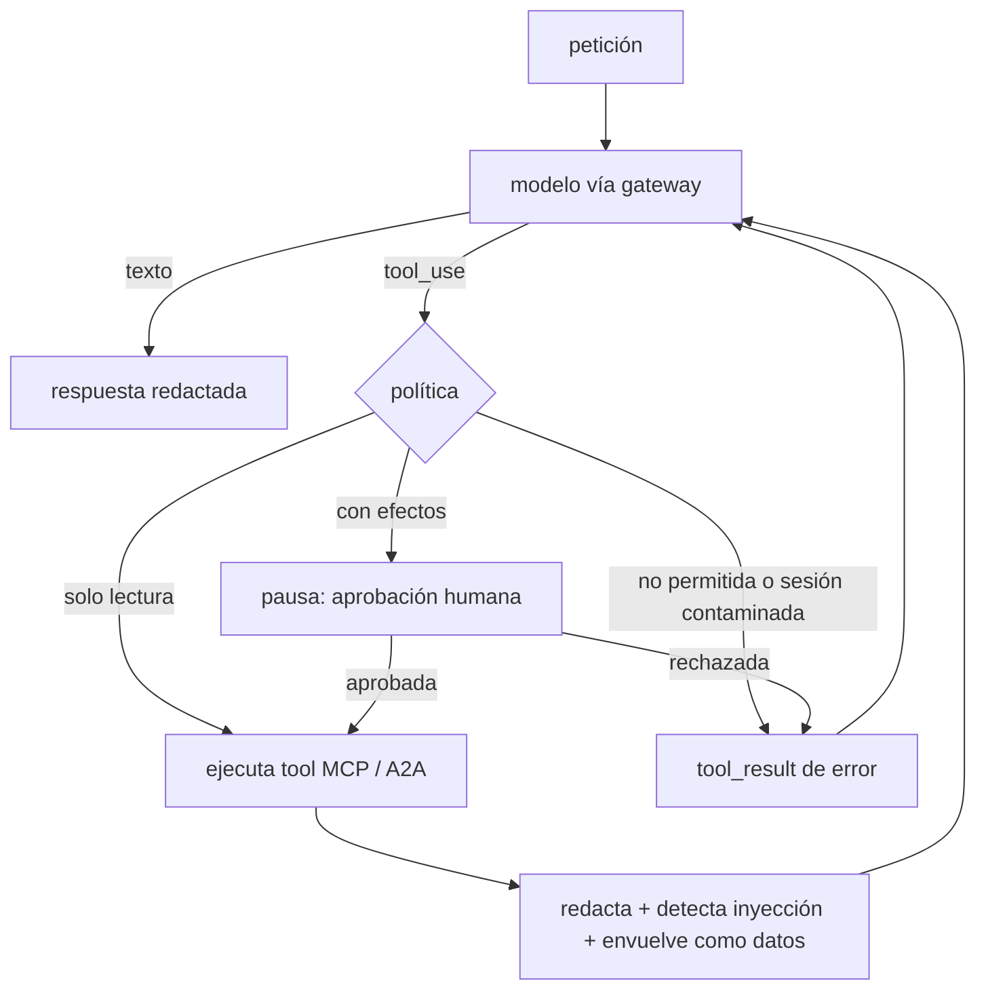

# reference-agent — ops-assistant

El agente de punta a punta del repositorio: un asistente de guardia que diagnostica
problemas de servicios y recomienda mitigaciones. Integra el resto de piezas:

| Pieza | Cómo la usa |
| --- | --- |
| [`llm-gateway`](../llm-gateway/) | SDK oficial de Anthropic apuntando al `/v1/messages` de LiteLLM |
| [`mcp`](../mcp/) | estado de servicios y de la plataforma, despliegues, runbooks (RAG) e incidentes |
| [`a2a`](../a2a/) | delega en el *change advisor* (otro equipo) si una acción está permitida |
| [`guardrails-security`](../guardrails-security/) | política por tool, aprobación humana, contaminación por inyección, redacción |
| [`rag-and-memory`](../rag-and-memory/) | sesiones con TTL; la recuperación vive en el servidor MCP |
| [`observability`](../observability/) | span `invoke_agent` del que cuelgan el modelo, MCP y A2A; tokens y coste |
| [`evals-and-benchmarks`](../evals-and-benchmarks/) | evals de trayectoria y juez calibrado sobre este agente |

## El bucle



Decisiones (detalle en [`architecture/adr/0001`](../architecture/adr/0001-bucle-propio.md)):

- **Bucle propio.** Cada control de seguridad necesita un punto explícito en el bucle, y
  la aprobación humana se reanuda en otra petición HTTP. El bucle completo cabe en
  [`agent.py`](src/opsagent/agent.py).
- **Historial append-only.** Una respuesta con `refusal` o `max_tokens` no se añade, así
  nunca queda un `tool_use` sin su `tool_result`. Con el razonamiento adaptativo de los
  modelos actuales, editar turnos anteriores invalida sus bloques de *thinking*.
- **Contaminación pegajosa.** Si un resultado de tool parece una inyección, las tools con
  efectos se deniegan durante el resto de la sesión, porque el contenido sigue en el contexto.
- **Recomienda, no ejecuta.** La única acción con efectos es declarar un incidente, y
  siempre con aprobación humana.

## Uso

```bash
uv run opsagent        # CLI: MCP por stdio y change advisor en proceso; solo necesita ANTHROPIC_API_KEY
uv run opsagent-api    # API HTTP (es lo que se despliega)
```

```bash
curl -s localhost:8080/v1/chat -H "Authorization: Bearer $TOKEN" \
  -d '{"message": "payments-api da 503, ¿qué hago?"}'
# → {"session_id": "...", "reply": "...", "stop": "end_turn" | "approval_required", "pending_approval": {...},
#    "trajectory": [...], "usage": {...}, "cost_usd": 0.03, "tainted": false}
curl -s localhost:8080/v1/sessions/$SESSION/approval -H "Authorization: Bearer $TOKEN" -d '{"approve": true}'
```

## Configuración

| Variable | Por defecto | Para qué |
| --- | --- | --- |
| `OPSAGENT_MODEL` / `OPSAGENT_EFFORT` | `claude-opus-5-5` / `medium` | modelo y esfuerzo de razonamiento |
| `OPSAGENT_MAX_ITERATIONS` / `OPSAGENT_MAX_TOOL_CALLS` | 8 / 12 | límites por petición |
| `LLM_GATEWAY_URL` / `LLM_GATEWAY_KEY` | — | gateway; sin él, API de Anthropic directa |
| `MCP_URL` / `MCP_TOKEN` | — | servidor MCP; sin URL, subproceso stdio |
| `ADVISOR_URL` / `ADVISOR_TOKEN` | — | change advisor A2A; sin URL, en proceso |
| `AGENT_API_TOKENS` | — | tokens aceptados por la API (lista JSON); sin ellos no arranca |

## Tests

`tests/` recorre el bucle real con un modelo con guion ([`testing.py`](src/opsagent/testing.py)),
el servidor MCP en memoria y el change advisor por A2A en proceso. Cubre diagnóstico
completo, aprobación aceptada, rechazada e implícita, inyección que bloquea efectos,
`refusal`, límite de pasos, tools fuera de la lista blanca, redacción, la API HTTP, el
árbol de spans y que el historial siempre es válido para la API.
